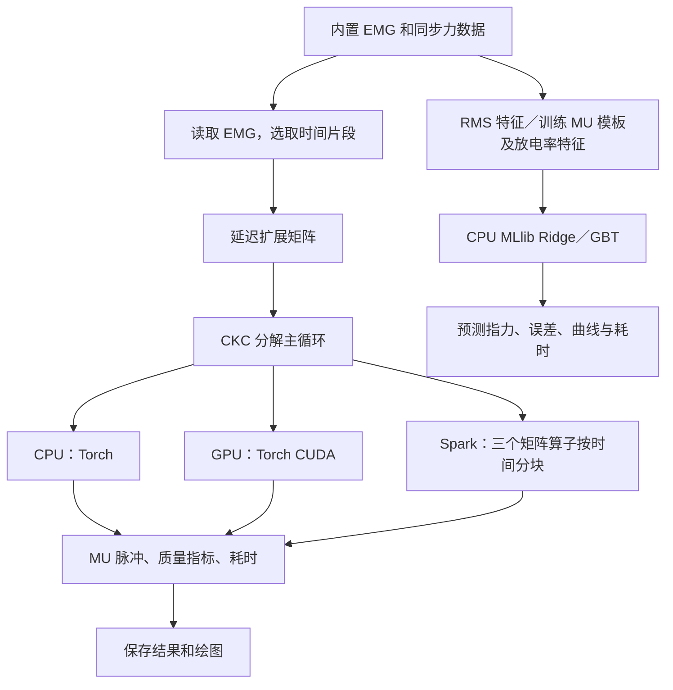

# 从零到交付：VMware Ubuntu 项目实操指南

更新：2026-10-28。本页合并原 START、VMware 环境和 SSH 第 6–8 步指南，作为 VMware 路线的唯一操作入口。第 6–12 节沿用原 SSH 指南编号，前五节统一为环境与本地验证，不再来回切换文档。

Windows 负责编辑、传输和查看结果；Ubuntu 负责 Python、Spark 与 Docker 运算。除标为 **Windows PowerShell** 的代码块外，运行命令都在 **Ubuntu SSH 的 `~/projects/spark-mu-decomp` 项目目录**执行。遇到错误先保留首个报错，不继续执行依赖它的下一块命令。

<a id="current-stage"></a>

## 阅读路线与当前进度

**本轮已完成环境、本地验证、容器 MU／预测和正式对照，结果已传回 Windows，容器已关闭。[报告 Markdown 初稿](report/COURSE_REPORT.md)、七张配图和 [精选结果](report/results/RESULTS_GUIDE.md) 已整理到 `docs/report/`，现在对照第 10 节复核和准备交付，不必重跑实验。**具体批次、数据及验证边界统一记录在 [知识库当前验收](knowledge-base/KNOWLEDGE.md#current-validation)。下面是复现步骤，不要求已完成者重新从头执行。

| 阶段 | 内容 |
|---|---|
| [项目概览](#overview) | 两条主线、架构、数据和脚本职责 |
| [1. 连接与代码传输](#step-1) | VM、SSH、首次传入与后续同步 |
| [2. 网络与运行环境](#step-2) | 代理、Java、Python、环境算例 |
| [3. CPU 分解](#step-3) | 数据图和真实 MU |
| [4. Spark local 与计时](#step-4) | 本地分解、结果检查和 benchmark |
| [5. Docker 前置条件](#step-5) | Engine 和权限 |
| [6. 受限容器 MU](#step-6) | 构建、双 worker 算例、CPU／Spark 单次验收 |
| [7. RMS＋Ridge](#step-7)／[8. MU＋GBT](#step-8) | 特征、预测与检查 |
| [9. 正式对照](#formal-comparison) | 固定批次、预热、重复与汇总 |
| [10. 课程报告](#course-report) | 已有 Markdown 初稿，当前复核与准备交付 |
| [11. 结果回传](#export-results) | 本地、单次容器和正式批次分别回传 |
| [12. 结束与恢复](#vm-resume) | 关闭、重连、页面转发和重试 |

### 窗口与路径约定

| 项目 | 本轮示例值 | 队友使用时 |
|---|---|---|
| Windows 仓库 | `E:\机动2311\大四上\大数据\spark-mu-decomp` | 将代码块中的此路径替换为自己的仓库位置 |
| SSH 目标 | `bigdata@192.168.135.128` | 替换用户和 VM 地址；IP 变化时重新查询 |
| Ubuntu 项目 | `~/projects/spark-mu-decomp` | 下文统一采用此目录 |
| Windows HTTP／混合代理 | `127.0.0.1:7892` | 仅联网需要代理时使用，先确认端口 |
| Ubuntu 转发代理 | `127.0.0.1:17892` | 由 SSH 反向隧道提供 |
| Windows 接收目录 | 仓库下 `outputs/vm-results` | 被 Git 忽略，不随提交上传 |

`PS ...>` 是 Windows PowerShell；`bigdata@ubuntu-bigdata:...$` 是 Ubuntu SSH。`ssh -N` 隧道窗口持续等待是正常现象，使用时保持开启。误把 PowerShell 命令粘入 Ubuntu 后若出现 `>` 续行提示，按 **Ctrl+C** 取消，再换到正确窗口。

<a id="overview"></a>

## 项目概览

### 两条主线

一句话：用真实肌电数据，在一台电脑上模拟 Spark 集群，比较不同计算方式与资源分配的效果，再用肌电特征预测手指用力大小。

#### 主线 A：MU 分解与计算效率

EMG 是电极采到的混合肌电信号。MU 是运动单位，可先理解成组成混合信号的一类神经肌肉活动来源。CKC 是这里复用的分解算法，目标是从多通道 EMG 找到各个 MU 的放电时刻。

这条线的输入是 EMG，输出是若干组放电脉冲、质量指标和计算时间。CPU、GPU、Spark 运行的是同一套分解流程，区别主要在矩阵运算在哪里执行。实验先检查结果是否一致，再比较耗时。

#### 主线 B：指力预测

这条线的输入是 EMG 特征，输出是每个时间窗口的预测指力。同步测到的真实指力用于训练与评价。

- RMS 特征：每个通道在一个时间窗口内的信号强度，作为容易实现的基线。
- MU 特征：把 MU 放电脉冲转换成窗口内的放电率，作为另一种输入表示。
- Ridge：带 L2 正则化的线性回归，使用 Spark MLlib 实现。
- GBT：梯度提升树回归，使用 Spark MLlib 实现。

当前计划要求 RMS＋Ridge、MU＋GBT；MU＋Ridge 可补充，用来区分特征变化和模型变化带来的效果。只比较 RMS＋Ridge 与 MU＋GBT 时，两种因素同时变化，不能把差异全部归因于 MU 特征。

### 架构与模块



图中流程均已有代码入口；是否实际通过验收，以知识库记录为准。

#### 运行入口与文件

| 文件或目录 | 你可以把它理解为 |
|---|---|
| `src/mu_course/__main__.py` | `python -m mu_course` 的入口，转交给主实验脚本 |
| `src/mu_course/run_experiment.py` | 总指挥：读参数、取数据、选择后端、运行、保存结果 |
| `src/mu_course/ckc/ckc_extender.py` | 把各 EMG 通道增加延迟副本，供 CKC 使用 |
| `src/mu_course/ckc/ckc_decomposer.py` | CKC 算法主体，也包含模板应用等辅助函数 |
| `src/mu_course/spark_ops.py` | 当前 Spark 接入的全部三个矩阵算子 |
| `src/mu_course/dataset.py` | 读取完整的同步 EMG／力试次 |
| `src/mu_course/ckc/mu_feature.py` | MU 放电率编码，已由预测特征入口调用 |
| `src/mu_course/benchmark.py` | 每配置预热一次、正式重复计时、保存 CSV |
| `src/mu_course/plot_results.py` | 画 MU 脉冲图或平均总计算耗时图 |
| `scripts/environment_smoke.py` | 简单平方和算例，只检查环境能否工作 |
| `scripts/submit.py` | 供 `spark-submit` 调用真实 MU 入口 |
| `src/mu_course/prepare_prediction.py` | RMS／固定训练模板 MU 特征、标签与元数据 |
| `src/mu_course/predict_force.py` | MLlib Ridge／GBT、独立测试预测、指标与图 |
| `scripts/run_vm_stage.sh` | 第 6–8 步的 Ubuntu 容器运行命令 |
| `scripts/check_mu_results.py`、`check_prediction_results.py` | 6.4／8.3：读取单次结果并保存检查记录，不重新训练 |
| `scripts/run_formal_group.sh` | 9.5／9.6：实际运行正式实验，各组预热一次、正式三次 |
| `scripts/check_formal_mu.py`、`summarize_formal.py` | 9.7／9.8：读取正式结果、检查、汇总和绘图 |
| `environment/` | Docker 镜像、基础 Compose 与资源限额覆盖配置 |
| `tests/` | 数据、输入选择、Spark 数值与 CUDA 等检查 |

初学时先看 `run_experiment.py`，再看 `spark_ops.py`；暂时不需要从头读一千多行 CKC 算法。

#### Spark 到底分布式了什么

当前 Spark 接入的是：相关矩阵、向量投影、加权求和。它把扩展后的矩阵沿时间轴分块，每一块保留全部扩展通道。

driver 仍保留完整数据，并负责求逆、候选选择、质量判断和全局更新。因此当前实现研究的是部分算子的分布式执行，并未解决输入超过单机内存的问题。

Docker 中几个角色的关系：

```text
master：登记 worker、分配应用资源
  ├─ worker-1：启动 executor，执行分块任务
  └─ worker-2：启动 executor，执行分块任务

driver：控制整个 MU 程序，提交任务并收回结果
```

master、worker、driver 都是同一台电脑上的容器。`local[2]` 则是在一个本地 Spark 进程环境中使用两个计算线程，与两个容器节点不同。`--partitions 4` 表示四个任务分区，也不等于四个 worker。

### 数据与时间约定

不需要再寻找原研究仓库，也不需要先准备 MAT 文件。以下内容已随仓库提供：

| 项目 | 第一试次 | 第二试次 |
|---|---|---|
| 文件 | `ldx_0deg_1.npz` | `ldx_0deg_2.npz` |
| 来源试次 | `session0_1` | `session0_2` |
| EMG 形状 | `[60, 63582]` | `[60, 63629]` |
| 记录长度 | 约 31.05 秒 | 约 31.07 秒 |
| 同步力 | `[2, 63582]` | `[2, 63629]` |

共同采样率 2048 Hz，即每秒 2048 个采样点；60 行对应两个试次共同有效的物理通道。力的第一路是中指屈曲，第二路是伸展，原始单位为 g。屈曲 `%MVC = force[0] / 2220.267 * 100`；本指南预测统一使用 g。

默认 MU 演示只取第 3–5 秒，得到 `[60, 4096]` 的输入。扩展系数为 10 时通道维变成 600；实现还裁掉边缘样本，因此扩展后时间维并非仍为 4096。分解输出的脉冲索引相对于扩展后矩阵，换回所选片段时间需补 `ext_factor / fsamp`，换回完整试次还需加 `start`。

**预测应覆盖力变化的轨迹，不能把默认的两秒分解演示当成完整预测训练集。**

### 要求对应与范围

| 课程要求 | 本页位置 |
|---|---|
| Python 3.11、Java 17、锁定依赖、CPU 镜像 | 第 2、6.1 节 |
| 原 CKC 循环、三个 Spark 算子、正确性 | 项目概览、6.4、8.3、9.7 |
| 容器硬限额、同总额度 CPU 基线、真实 worker 参与 | 6.1–6.4 |
| 训练／测试隔离、固定训练模板、通道／时间／标签一致 | 第 7–8 节 |
| 增加资源、固定 worker 总预算、分区变化、ML local／standalone | 第 9 节 |
| 原始结果、资源证据、重复统计、图表和报告 | 第 9–11 节 |

本路线必做 CPU／Spark；CUDA MU 仅是独立历史参考。无 GPU 不阻塞本页，ML 只使用 CPU。HDFS、Kubernetes、Transformer、区间预测和网络限速不是本轮必做项。

### 按需查阅

范围查 [课程计划](../SPARK_MU_COURSE_PROJECT_PLAN.md)，接口查 [开发说明](DEVELOPMENT.md) 和 [Spark 算子](BACKEND_CONTRACT.md)，数据查 [数据说明](../src/mu_course/data/README.md)，算法来源查 [SOURCE](../src/mu_course/ckc/SOURCE.md)，历史查 [决策](knowledge-base/DECISIONS.md)。实际进度与验收边界集中在知识库；本页维护可复现的操作步骤。

<a id="step-1"></a>
<a id="vm-access"></a>

## 1. 连接虚拟机并传入代码

本轮复用 `ubuntu-bigdata`：Ubuntu 24.04.5、Linux x86_64、2 vCPU、6 GB 内存、50 GB 虚拟磁盘、NAT。无需新建 VM；两个 worker 共享同一台电脑，不是两台物理服务器。正式批次运行期间固定 VM 配置。

在 **Windows PowerShell** 登录；已有 SSH 窗口则直接使用：

```powershell
ssh bigdata@192.168.135.128
```

在 **Ubuntu SSH** 查询当前资源：

```bash
whoami
cat /etc/os-release
uname -m
hostname -I
nproc
free -h
df -h / /home
```

`/` 与 `/home` 若为同一分区，可用空间不能相加。Swap 不能替代物理内存作为正式实验资源。启动实验前检查无关课程服务占用，不删除旧实验数据。

<a id="vm-files"></a>

### 1.1 首次传入代码

第一轮采用“Windows 为主要编辑目录，Ubuntu 为运行副本”的方式。这样本地未提交的修改也能传过去，虚拟机不必先配置私有 GitHub 仓库认证。

Windows 上的 `E:\...` 不会在 VMware 中自动变成 `/mnt/e`。本项目在 Ubuntu 中放到 `~/projects/spark-mu-decomp`，直接使用虚拟机自己的 Linux 文件系统。

保留当前 SSH 窗口。另开 Windows Terminal 的 **PowerShell 标签页**，确认提示符为 `PS ...>`，在这个新标签页执行：

```powershell
$vmTarget = 'bigdata@192.168.135.128'
tar -czf "$env:TEMP\spark-mu-decomp-vm.tar.gz" -C 'E:\机动2311\大四上\大数据\spark-mu-decomp' pyproject.toml uv.lock .python-version .dockerignore .gitignore .gitattributes AGENTS.md README.md SETUP_PLAN.md SPARK_MU_COURSE_PROJECT_PLAN.md src scripts tests environment docs
if ($LASTEXITCODE -ne 0) { throw '打包失败，停止传输' }
scp "$env:TEMP\spark-mu-decomp-vm.tar.gz" "${vmTarget}:~/"
if ($LASTEXITCODE -ne 0) { throw '传输失败，停止解压' }
```

这是把当前运行所需的文件和文档打包传输，不包含 `.git`、根目录虚拟环境、下载缓存或实验输出；`src` 中的两份授权示例数据会一并传入。不需要执行 `commit`，也不会向 GitHub 上传内容。

在 **Ubuntu SSH 窗口**中首次解压：

```bash
mkdir -p ~/projects/spark-mu-decomp
tar -xzf ~/spark-mu-decomp-vm.tar.gz -C ~/projects/spark-mu-decomp
cd ~/projects/spark-mu-decomp
ls
ls -lh src/mu_course/data/*.npz
```

验收：能看到 `pyproject.toml`、`uv.lock`、`src`、`scripts`、`environment`，以及两份约 14 MB 的 NPZ。

首次搭建完成后，继续在 Windows 修改代码，再传更新到 Ubuntu。不要同时在两边修改同一文件后直接解压覆盖；这个包是运行快照，后续覆盖式解压也不会自动删除已经移除的旧源码。不要把 `.venv-wsl`、`.tools`、`.cache` 或 `outputs` 来回覆盖。运行副本没有 Git 历史，因此在里面 `git pull` 不适用；将来若改成 Ubuntu 直接维护 Git 工作区，再单独配置认证与同步方式。

### 1.2 后续更新运行副本

仅修改本指南时，在 Windows PowerShell 传一份即可：

```powershell
$vmTarget = 'bigdata@192.168.135.128'
$repoDir = 'E:\机动2311\大四上\大数据\spark-mu-decomp'
scp (Join-Path $repoDir 'docs\START_HERE.md') "${vmTarget}:~/projects/spark-mu-decomp/docs/"
if ($LASTEXITCODE -ne 0) { throw '文档传输失败' }
```

SCP 不会删除 Ubuntu 中的两份旧指南，以新的 `docs/START_HERE.md` 为入口即可。更新文档无需重装、重建镜像或重跑实验。

源码变动时，确认两边没有独立修改尚待合并，在 Ubuntu 备份现有运行副本，再按 1.1 打包／传输／解压：

```bash
cd ~/projects/spark-mu-decomp
tar -czf "$HOME/spark-mu-code-before-$(date +%Y%m%d-%H%M%S).tar.gz" src scripts tests environment docs pyproject.toml uv.lock
```

备份不包含环境与输出。源码／Dockerfile 改动后，在新批次前重建镜像；仅修改宿主机检查、汇总脚本无需重建。依赖变化时按第 2 节同步安装。不要在正式批次中途修改被冻结的脚本、输入、资源或镜像。

<a id="step-2"></a>
<a id="vm-network"></a>

## 2. 网络与运行环境

### 2.1 检查下载网络

在 **Ubuntu** 中检查：

```bash
curl -I --connect-timeout 10 --max-time 20 https://github.com
curl -I --connect-timeout 10 --max-time 20 https://pypi.org/simple/
curl -I --connect-timeout 10 --max-time 20 https://download.pytorch.org/whl/cpu/
```

GitHub 上普通的重定向是正常响应；这里主要排查域名解析、超时和连接被重置。若提示 `curl: command not found`，先在 Ubuntu 执行 `sudo apt-get install -y curl ca-certificates`。

<a id="vm-proxy"></a>

### 2.2 只有直连失败时：借用 Windows 上的代理

此前检测到 Windows 代理为 `127.0.0.1:7892`。需要确认代理软件仍开启、端口没有变化。**Ubuntu 内的 `127.0.0.1` 指向 Ubuntu 自己，不能直接照抄 Windows 的代理地址。**

可以用 SSH 把 Windows 代理转到 Ubuntu 的回环端口。在**另一个 Windows PowerShell 窗口**执行，并保持该窗口开启：

```powershell
$vmTarget = 'bigdata@192.168.135.128'
ssh -N -o ExitOnForwardFailure=yes -R 127.0.0.1:17892:127.0.0.1:7892 $vmTarget
```

这个窗口登录后没有命令提示符、持续等待，是隧道正常运行时的表现。作用是：Ubuntu 的 `127.0.0.1:17892` → SSH → Windows 的 `127.0.0.1:7892`。

回到原来的 **Ubuntu SSH 窗口**设置：

```bash
export http_proxy='http://127.0.0.1:17892'
export https_proxy="$http_proxy"
export HTTP_PROXY="$http_proxy"
export HTTPS_PROXY="$http_proxy"
export no_proxy='localhost,127.0.0.1,::1'
export NO_PROXY="$no_proxy"
curl -I --connect-timeout 10 --max-time 20 https://github.com
```

这些变量只在当前 Ubuntu shell 及其子进程生效。以后新开 Ubuntu 终端需要重新设置；隧道窗口关闭后代理转发失效。切换 Windows 代理节点但本地端口不变时，不需要更改这些地址。若需要停用，在 Ubuntu 中执行：

```bash
unset http_proxy https_proxy HTTP_PROXY HTTPS_PROXY no_proxy NO_PROXY
```

本节足以供后续普通用户执行的 curl／uv 使用。`sudo apt`、Docker daemon 和镜像构建中的下载是不同进程环境，不会因为设置了这里的变量就自动全部配置好；它们单独报错时应针对相应层处理。

<a id="vm-runtime"></a>

### 2.3 安装 Java 和项目 Python 环境

已安装且检查通过时跳过重装，新开 SSH 只需恢复下方环境变量。

在 **Ubuntu** 中执行：

```bash
cd ~/projects/spark-mu-decomp
sudo apt-get update
sudo apt-get install -y openjdk-17-jre-headless curl ca-certificates tar gzip
bash scripts/bootstrap_wsl.sh cpu
```

若 apt 也必须经过2.2 的代理，且当前 shell 已设置变量，可把上面两条 apt 命令分别换为：

```bash
sudo apt-get -o Acquire::http::Proxy="$http_proxy" -o Acquire::https::Proxy="$https_proxy" update
sudo apt-get -o Acquire::http::Proxy="$http_proxy" -o Acquire::https::Proxy="$https_proxy" install -y openjdk-17-jre-headless curl ca-certificates tar gzip
```

`bootstrap_wsl.sh` 名字带 WSL，但源码没有依赖 WSL 的系统调用；它检查 Linux x86_64，并执行普通 uv 安装流程，可以在 VMware Ubuntu 使用。它会：

1. 下载并校验仓库指定的 uv 0.11.19。
2. 按项目要求准备 Python 3.11。
3. 按 `uv.lock` 安装 CPU Torch、PySpark、绘图和开发依赖。
4. 把环境放到项目的 `.venv-wsl`，工具与缓存放到 `.tools`、`.cache`。

**`.venv-wsl` 在这里仅是文件夹名字，不表示正在使用 WSL。**不必为改名字而改脚本，也不必把 Ubuntu 系统 Python 改成 3.11。项目 Python 与系统 Python 可以共存。uv 可自动下载项目所需的 Python，见 [uv 官方说明](https://docs.astral.sh/uv/guides/install-python/)。

课程旧环境可能已有其他 Java、Spark 或 Python 配置。先在**当前 Ubuntu shell**中明确本项目使用的版本，不修改全局配置或 `.bashrc`：

```bash
export JAVA_HOME=/usr/lib/jvm/java-17-openjdk-amd64
export PATH="$JAVA_HOME/bin:$PATH"
export PYSPARK_PYTHON="$PWD/.venv-wsl/bin/python"
export PYSPARK_DRIVER_PYTHON="$PYSPARK_PYTHON"
unset SPARK_HOME
```

以上 Java 路径对应 Ubuntu amd64 的 `openjdk-17-jre-headless` 包；若该路径不存在，先核对软件包是否安装成功。清除当前 shell 继承的 SPARK_HOME 后，PySpark 会寻找项目依赖内自带的 Spark，避免误用以前课程配置的其他版本。

然后检查：

```bash
java -version
.venv-wsl/bin/python --version
.venv-wsl/bin/python -c "import torch, pyspark; print('Torch:', torch.__version__); print('Spark:', pyspark.__version__); print('CUDA:', torch.cuda.is_available())"
.venv-wsl/bin/python -m mu_course --help
```

验收：Java 17、项目 Python 3.11、Torch 2.8.0 的 CPU 安装、PySpark 3.5.7，帮助命令正常。CPU 环境 `CUDA: False` 正常。先完成 CPU／Spark 路线，不把宿主机有 NVIDIA 显卡等同于虚拟机已具备 CUDA。

如果 Java 版本仍不符，检查 `readlink -f "$(command -v java)"` 和 `printenv JAVA_HOME`，以实际 Java 17 安装路径为准。

<a id="vm-smoke"></a>

### 2.4 环境算例

```bash
.venv-wsl/bin/python scripts/environment_smoke.py --backend cpu
PYSPARK_PYTHON="$PWD/.venv-wsl/bin/python" .venv-wsl/bin/python scripts/environment_smoke.py --backend spark
```

验收：两条命令均正常退出，CPU 使用 cpu，Spark 输出分区信息。脚本内部会检查平方和 1240；它不执行 MU 分解。

<a id="step-3"></a>
<a id="vm-cpu"></a>

## 3. 真实数据和 CPU 分解

统一输出到 `outputs/vm-cpu`。

```bash
.venv-wsl/bin/python scripts/plot_example_data.py
.venv-wsl/bin/python -m mu_course --backend cpu --output outputs/vm-cpu
.venv-wsl/bin/python -m mu_course.plot_results outputs/vm-cpu
```

验收：生成 `outputs/example_data.png`、`outputs/vm-cpu/parameters.json`、`mu_results.npz` 和 `mu_pulses.png`。知识库中的“3 个 MU”是旧环境的一次实测记录，不是代码规定的输出数量或已知真实 MU 总数，不能把“必须恰好 3 个”当作验收条件。

MU 数由迭代、质量筛选和去重决定，不能为达到固定数量调整阈值。实际验证记录见知识库。

数据图脚本会打印路径，脉冲图脚本保存后不打印。需要确认两张图时，在 Ubuntu 执行：

```bash
ls -lh outputs/example_data.png outputs/vm-cpu/mu_pulses.png
```

<a id="step-4"></a>
<a id="vm-spark"></a>

## 4. Spark local 与本地重复计时

### 4.1 分解与测试

统一输出到 `outputs/vm-spark`。

```bash
.venv-wsl/bin/python -m mu_course --backend spark --master 'local[2]' --partitions 2 --output outputs/vm-spark
.venv-wsl/bin/python -m mu_course.plot_results outputs/vm-spark
.venv-wsl/bin/pytest -q
.venv-wsl/bin/ruff check src tests scripts
```

验收：Spark 真实分解完成，保存结果；现有测试通过，CUDA 项在 CPU 环境跳过。使用同一输入、参数比较 CPU／Spark 的 MU 数、质量及配对脉冲，不能只看 MU 数量相同。`local[2]` 是本地 Spark，不是双 worker 容器集群。

若出现本机 hostname 无法解析、driver 无法回连等错误，可先在当前 Ubuntu shell 执行 `export SPARK_LOCAL_IP=127.0.0.1` 后重试 local 模式；该设置只针对本地检查，正式 standalone 提交应使用 Compose 已定义的 driver 网络配置。

<a id="step-4-results"></a>

### 4.2 核对结果

核对两份 `parameters.json` 的输入、片段、采样率、扩展、候选数、迭代、阈值和 seed。读取 NPZ 的脉冲、SIL、PNR，先一对一配对 MU，再比较放电时刻；不假定相同行号是同一个 MU，也不只比较数量。保留原始文件供复核，本轮 local 验收记录见知识库。

<a id="step-4-timing"></a>

### 4.3 本地预热与重复计时

```bash
.venv-wsl/bin/python -m mu_course.benchmark --backends cpu spark --repeat 3 --partition-counts 1 2 4 --output outputs/local-comparison
.venv-wsl/bin/python -m mu_course.plot_results outputs/local-comparison
```

CPU 一组、Spark 1／2／4 分区三组，每组预热一次、正式三次，共 16 次运行，`timings.csv` 有 12 条正式记录，另有 `timings.png` 和逐次 NPZ／JSON。显式指定 CPU／Spark，避免默认列表包含 GPU。不能用单次时间替代重复均值，也不能将 local 与受限 Docker 结果混为一组。

<a id="step-4-export"></a>

本地结果回传统一见 [11.1](#vm-export)。可以在对应阶段结束后立即传回看图，不必等所有实验完成。

<a id="step-5"></a>
<a id="vm-docker"></a>

## 5. Docker 前置条件

复用 Ubuntu 内的 Docker Engine，Windows 无需安装 Docker Desktop。在 Ubuntu 检查：

```bash
systemctl is-active docker
docker version
docker compose version
docker ps
```

服务应为 `active`，客户端和服务端均可连接，带空格的 `docker compose` 可用。只有 Docker 未安装时，才按 [Docker 官方 Ubuntu 安装说明](https://docs.docker.com/engine/install/ubuntu/) 或课程已有离线包安装 Engine 和 Compose plugin；已有安装不重装或先卸载。正式实验前识别并停止无关课程服务，不停止所有容器或删除旧数据。

若 `docker ps` 报 socket 权限不足，设置普通用户权限，然后重新登录 SSH：

```bash
sudo usermod -aG docker "$USER"
exit
```

重新连接后按 [第 12 节](#vm-resume) 恢复当前 shell。此处不再执行无硬限额的旧算例：统一进入 6.1 构建带限额配置，在 6.2 验收两个 worker。

<a id="step-6"></a>

## 6. 受限 Docker 与真实 MU

### 6.1 检查 Docker，准备目录权限和镜像

```bash
systemctl is-active docker
docker version
docker compose version
docker ps --format 'table {{.Names}}\t{{.Status}}\t{{.Ports}}'
docker stats --no-stream
free -h
df -h /
```

应看到 Docker 服务 `active`，客户端与服务端均可连接，并且 `docker compose` 可用。旧 Hadoop／Hive／HBase 实验服务若还在运行，先识别容器名称，再用 `docker stop 容器名` 停止不参与本项目的服务；不要停止所有容器或删除旧实验数据。Docker 不可用时先回 [第 5 节 Docker 安装与权限说明](#vm-docker)。

镜像以 UID 10001 运行。为它单独开放本项目输出目录的读写权限，使用 ACL 保留原来的目录所有者：

```bash
mkdir -p data outputs
if ! command -v setfacl >/dev/null; then
  sudo apt-get update && sudo apt-get install -y acl
fi
sudo setfacl -m u:10001:rwx outputs
sudo setfacl -m d:u:10001:rwx,d:u:$(id -u):rwx outputs
getfacl outputs
docker compose -f environment/compose.yaml -f environment/compose.limits.yaml config --quiet
if docker compose -f environment/compose.yaml -f environment/compose.limits.yaml build; then
  docker compose -f environment/compose.yaml -f environment/compose.limits.yaml run --rm --no-deps cpu python -c "from pathlib import Path; p=Path('/workspace/outputs/.write-check'); p.write_text('ok'); p.unlink(); print('Output writable')"
else
  printf '%s\n' '镜像构建失败，停止后续操作；基础镜像连接重置时看下方代理排障。'
fi
```

验收：配置命令不报错、镜像构建成功、最后打印 `Output writable`。网络报错先分清是镜像拉取还是构建中的 apt／uv；先前的 SSH 代理只配置了 Ubuntu shell，不会自动配置 Docker 的所有下载进程。保留首个报错，按 [第 2 节网络说明](#vm-network) 排查，不重装已经成功的 Python 环境。

本次使用两份 Compose 文件：原配置提供服务，`compose.limits.yaml` 增加硬限额和 CPU 服务。后面的脚本自动带齐这两个 `-f`，不要只启动原配置后宣称已经限额。

| 服务 | CPU 上限 | 内存硬上限 | 作用 |
|---|---:|---:|---|
| master | 0.25 核 | 384 MiB | 集群协调，daemon heap 128 MiB |
| worker-1 | 0.5 核 | 1280 MiB | 一个任务槽；executor heap 512 MiB |
| worker-2 | 0.5 核 | 1280 MiB | 一个任务槽；executor heap 512 MiB |
| driver | 0.75 核 | 1792 MiB | 控制程序与全局计算，提交时 heap 768 MiB |
| CPU 基线 | 2 核 | 4736 MiB | 集群停止后单独运行，Torch 两线程 |

集群合计 CPU 2 核、内存 4736 MiB，与 CPU 基线的总额度相同；CPU 阶段会停止本项目 master／worker，避免它们竞争资源。Spark 的一任务槽与容器 0.5 CPU 配额是不同概念：该任务可以运行，但 CPU 时间受限。两种执行结构的单进程额度和线程布局不同，报告必须保留此表，不能称为完全相同的运行环境。

这组限额用于 2 vCPU／6 GB 的小输入实验；新负载是否适用仍须实测，成功运行不等于测得峰值内存余量。内存总额度含 JVM 和 Python；设置相同的 `memswap_limit` 禁止容器额外使用 swap。若出现退出码 137 或 OOM，保留日志并检查 `docker stats`、`free -h`，再一致调整配置和记录，不能跳过该项继续写“通过”。

<a id="docker-pull-proxy"></a>

### 6.1a 基础镜像下载被重置：配置 Docker 下载代理

如果 `FROM python:3.11-slim-bookworm` 获取 Docker Hub 元数据时出现 `connection reset by peer`，说明基础镜像下载失败。此时镜像尚未构建，后续 `run` 又试图从 Docker Hub 下载本项目的本地镜像 `spark-mu-course:dev`，这是构建失败后的连带现象。先恢复基础镜像下载，不做 Docker 登录、不重装 Python、不进入 6.2。

**Windows 新开 PowerShell**，确认代理软件仍提供 HTTP／混合代理端口 7892，然后建立之前用过的隧道并保持窗口开启：

```powershell
ssh -N -o ExitOnForwardFailure=yes -R 127.0.0.1:17892:127.0.0.1:7892 bigdata@192.168.135.128
```

若明确提示远程端口转发失败，先检查是否已有相同隧道窗口，不重复开启。代理端口若已改变，应替换右侧 `7892`。回到 **Ubuntu SSH** 验证 Docker Hub 经隧道可达：

```bash
curl --proxy http://127.0.0.1:17892 -I --connect-timeout 10 --max-time 30 https://registry-1.docker.io/v2/
```

应看到最终 `401 Unauthorized`，这是未登录访问 registry API 的正常认证挑战，说明 HTTPS 已连接到 registry；前面的 `200 Connection established` 只说明代理建立了隧道。超时或连接拒绝时先修复隧道，不继续配置 Docker。

Docker daemon 不继承 SSH shell 的 `export`。按 [Docker 官方 daemon 代理说明](https://docs.docker.com/engine/daemon/proxy/)，新增专用 systemd 配置，不覆盖已有 `daemon.json`：

```bash
sudo mkdir -p /etc/systemd/system/docker.service.d
sudo tee /etc/systemd/system/docker.service.d/spark-mu-proxy.conf > /dev/null <<'EOF'
[Service]
Environment="HTTP_PROXY=http://127.0.0.1:17892"
Environment="HTTPS_PROXY=http://127.0.0.1:17892"
Environment="NO_PROXY=localhost,127.0.0.1,::1,master,worker-1,worker-2,driver"
EOF
sudo systemctl daemon-reload
sudo systemctl restart docker
systemctl is-active docker
docker info --format 'HTTP proxy={{.HTTPProxy}} HTTPS proxy={{.HTTPSProxy}}'
docker pull python:3.11-slim-bookworm
```

重启会影响正在运行的容器，执行前先保存任务并检查容器状态。应显示 `active`，有效代理地址为 `127.0.0.1:17892`，拉取成功。若有效地址不同，可能已有更高优先级的 daemon 配置；保留输出排查，不直接覆盖旧配置。

基础镜像 pull 成功后，回 6.1 重新执行构建与写权限检查。若接下来失败在 `RUN apt-get` 或 `uv sync`，说明是**构建容器里的下载**：它的 `127.0.0.1` 与 Ubuntu 不同，daemon 代理不自动配置这些命令。保留这次新报错；Linux 下可单独采用 host 构建网络和预定义代理参数（只影响构建，不改变运行中的内部网络）：

```bash
docker build --network host \
  --build-arg HTTP_PROXY=http://127.0.0.1:17892 \
  --build-arg HTTPS_PROXY=http://127.0.0.1:17892 \
  --build-arg http_proxy=http://127.0.0.1:17892 \
  --build-arg https_proxy=http://127.0.0.1:17892 \
  -f environment/Dockerfile -t spark-mu-course:dev .
```

代理构建参数见 [官方说明](https://docs.docker.com/build/building/variables/#proxy-arguments)。此命令成功后直接执行 6.1 的 `run ... Output writable` 检查，不再立即重复一次不带构建代理的 Compose build。

此 daemon 配置会保留；以后需要下载镜像时保持隧道可用。若决定恢复直接下载，只撤销本节创建的配置文件：

```bash
sudo rm -f /etc/systemd/system/docker.service.d/spark-mu-proxy.conf
sudo systemctl daemon-reload
sudo systemctl restart docker
```

### 6.2 先验收两个 worker

```bash
bash scripts/run_vm_stage.sh smoke
docker compose -f environment/compose.yaml -f environment/compose.limits.yaml ps
cat outputs/docker-logs/smoke-limits.txt
```

环境算例应结束并打印 `Completed stage: smoke`；两个 worker 实际参与，平方和合计 1240。`*-limits.txt` 保存 Docker 返回的 CPU 纳核数和内存字节数，`compose.resolved.yaml` 保存解析后的配置。页面查看方法见 [SSH 转发 Master UI](#vm-ui)。

### 6.3 运行受限 CPU 基线

```bash
bash scripts/run_vm_stage.sh cpu
cat outputs/docker-cpu/parameters.json
ls -lh outputs/docker-cpu/
```

应有 `parameters.json`、`mu_results.npz`、`mu_pulses.png`。输入仍是第一个试次的 3–5 秒，扩展 10、候选数 5、迭代 30、seed 42；CPU 使用两线程，与旧的单线程 `vm-cpu` 分开保存。当前不是三次正式计时，只是一次容器验收。

### 6.4 运行双 worker 真实分解

```bash
bash scripts/run_vm_stage.sh spark
cat outputs/docker-spark/parameters.json
ls -lh outputs/docker-spark/
```

脚本会保留 client driver 的回连设置，提交真实入口 `scripts/submit.py`，完成绘图，并检查两个 `worker_hosts` 和非零 MU 数。最后应打印 `Two workers participated` 和 `Completed stage: spark`。仅有 Master UI 的两个注册节点不够。

两边的 JSON 新增 `runtime.cgroup`，记录运行进程实际看到的 CPU／内存限制。Linux cgroup v2 通常有 `cpu.max`、`memory.max`；CPU 预期 2 核、driver 预期 0.75 核。已有本地结果不含该字段，不需要重跑覆盖。

先查看数量和计时：

```bash
.venv-wsl/bin/python - <<'PY'
import json
from pathlib import Path
for name in ['docker-cpu', 'docker-spark']:
    result = json.loads((Path('outputs') / name / 'parameters.json').read_text())
    print(name, 'MU=', result['mu_count'], 'seconds=', result['total_seconds'],
          'hosts=', result['worker_hosts'], 'runtime=', result['runtime'])
PY
```

验收还需要检查 CPU／Spark 配对后的放电时刻、SIL、PNR，不能只凭 MU 数相同。保留两套 NPZ，按本页末尾传回后可继续核对。此处不把“必须 4 个”写成算法条件。Docker 结果也不能直接与旧的单线程 local 耗时混为同组实验。

以下核对单次真实结果并保存检查记录。配对后脉冲数相同、最大偏差不超过 1 样本是本页的工程一致性判据；PNR／SIL 保存配对原值与差值，不凭 MU 数量判断。不通过时保留差异排查，不能删掉不匹配的 MU。

```bash
.venv-wsl/bin/python scripts/check_mu_results.py
```

另核对 `runtime.cgroup` 和 `spark-limits.txt` 是否符合 6.1 配额表。cgroup v2 的 CPU 核数为 `cpu.max` 中配额除以周期，内存字节数除以 1048576 得 MiB；driver／CPU 的限制来自各自 JSON，master／worker 来自 Docker inspect。上述数值检查不替代资源验收，也不证明提取了全部真实运动单位。

<a id="step-7"></a>

## 7. RMS＋Ridge：先完成一条预测流程

第一份 `ldx_0deg_1.npz` 训练、第二份 `ldx_0deg_2.npz` 测试；这是当前明确的工作配置。预测中指屈曲力，单位 g。固定 200 ms 窗口、50 ms 步长，取整后分别是 410、102 样本，实际步长约 49.8 ms。

### 7.1 准备 RMS 特征

```bash
bash scripts/run_vm_stage.sh rms-features
cat outputs/prediction-rms/metadata.json
head -n 2 outputs/prediction-rms/train.csv
```

输入用完整约 31 秒试次；不沿用前面仅 2 秒的 MU 结果文件。每个窗口计算 60 通道 RMS，标签取同窗口力的平均值。为了与第 8 步 MU 居中平滑后的有效范围一致，两端统一去掉 430 样本。

默认数据预期得到 611 个训练窗口、612 个测试窗口、60 维特征。目录包含 `features.npz`、`train.csv`、`test.csv`、`metadata.json`；元数据记录输入 SHA256、通道、整数窗口、单位和准备耗时。

### 7.2 用 MLlib Ridge 训练并测试

```bash
bash scripts/run_vm_stage.sh rms-ridge
cat outputs/rms-ridge/metrics.json
head -n 5 outputs/rms-ridge/predictions.csv
ls -lh outputs/rms-ridge/
```

Ridge 使用 `LinearRegression` 的 `normal` 求解器，L2 正则化系数 0.1，标准化统计来自训练集。参数在测试前固定；不依据测试曲线选参数。输入分发的实际 host 名保存在 `input_worker_hosts`；这个字段证明输入任务在哪些节点执行，不表示每个训练阶段都使用了两个节点，训练任务可在 Spark UI 核对。

输出：`metrics.json`、`predictions.csv`、`prediction.png`、`feature_metadata.json` 和保存模型的 `model/`。RMSE／MAE 单位都是 g；`train_mean_baseline_rmse` 是只预测训练力均值的简单对照。误差不预设合格数值；如果比均值基线差，也要如实记录并检查训练／测试分布。

`startup_seconds`、`distribution_seconds`、`fit_seconds`、`predict_seconds` 分开记录。总计时从 Spark 启动到预测收集完成，不含特征准备、模型保存和绘图。特征准备耗时在上一小节元数据中，不能漏记后称为端到端耗时。

<a id="step-8"></a>

## 8. 固定训练 MU 模板＋GBT

### 8.1 提取训练模板并准备两份试次的 MU 特征

```bash
bash scripts/run_vm_stage.sh mu-features
cat outputs/prediction-mu/metadata.json
ls -lh outputs/prediction-mu/
```

默认只在训练试次的 3–5 秒提取模板，再将**同一套模板**应用到完整训练试次和完整测试试次。这个短片段是先跑通流程的起点，不保证覆盖全部运动单位；后续若改变模板片段，依据训练数据决定，并重新准备特征、重新训练。

保存 `templates.npz`：包括投影矩阵、训练阈值质心、固定正负方向、通道顺序、采样率、扩展系数、训练片段样本范围和来源哈希。入口实际重新载入此文件后应用，旧 `mu_results.npz` 仍不是完整模板文件。

两份试次都生成相同数量、相同含义的 MU 列；某列没有放电时保留零列。`train_pulses.npz`／`test_pulses.npz` 中脉冲已补偿扩展裁剪的 10 样本，索引相对于各自完整试次起点。400 ms Hanning 是居中平滑，包含未来邻域，因此当前任务明确为**离线指力预测**，不宣称实时预测。

检查 RMS／MU 窗口、标签是否完全一致，训练／测试模板列数是否固定：

```bash
.venv-wsl/bin/python - <<'PY'
import numpy as np
with np.load('outputs/prediction-rms/features.npz') as rms, np.load('outputs/prediction-mu/features.npz') as mu:
    for split in ['train', 'test']:
        for field in ['starts', 'stops', 'y']:
            np.testing.assert_array_equal(rms[f'{split}_{field}'], mu[f'{split}_{field}'])
        assert np.isfinite(mu[f'{split}_x']).all()
        print(split, 'RMS', rms[f'{split}_x'].shape, 'MU', mu[f'{split}_x'].shape)
    assert mu['train_x'].shape[1] == mu['test_x'].shape[1] > 0
print('Window, label and feature-column checks passed')
PY
```

查看 `metadata.json` 的 `pulse_counts`。测试试次可能有静默 MU，不能自行删列或重新独立提取一套“测试模板”。如果所有训练特征都为常数，程序会停止；若测试全部静默，则应在解释结果时明确指出。

### 8.2 运行 MU＋GBT

```bash
bash scripts/run_vm_stage.sh mu-gbt
cat outputs/mu-gbt/metrics.json
ls -lh outputs/mu-gbt/
```

默认 GBT 为 20 棵树、深度 3、stepSize 0.1、seed 42，全部在 CPU 上训练。输出结构与 RMS＋Ridge 相同。

建议再运行 MU＋Ridge 作为对照，它直接复用已经准备好的 MU 特征：

```bash
bash scripts/run_vm_stage.sh mu-ridge
cat outputs/mu-ridge/metrics.json
```

RMS＋Ridge 与 MU＋GBT 同时改变了特征和模型；补 MU＋Ridge 后更容易区分这两个因素。两份试次只支持本数据条件下的课程实验，不代表跨人或跨姿态泛化。

### 8.3 跑新增测试，检查实际结果

保持 SSH 位于项目根目录：

```bash
.venv-wsl/bin/ruff check src tests scripts
.venv-wsl/bin/pytest -q -rs
```

测试包括真实数据特征／模板、样本对齐、静默列保留、固定方向，以及小型 MLlib Ridge／GBT 的模型保存和重新载入。CUDA 在本 VM 中跳过是预期情况；两个新增 MLlib 测试应执行通过，若提示缺 pyspark 而跳过，不能算第 7–8 步验收完成。测试运行的是 local Spark，不代替上面的双 worker 容器验收。

`-rs` 会列出跳过原因；黄色 `DeprecationWarning` 本身不是失败。已经得到上述通过结果的这次运行不必只为补选项重跑。

下面核对**实际预测输出**，必做的 RMS＋Ridge、MU＋GBT 缺失会停止，只有 MU＋Ridge 可跳过。检查文件齐全、训练／测试隔离、RMS／MU 对齐、预测时间和标签、指标重算及双 worker 输入执行记录。不会重做训练；通过后保存 `outputs/stages-6-8-check/prediction-check.json`，用于回传核对。

```bash
.venv-wsl/bin/python scripts/check_prediction_results.py
```

检查失败时按报出的文件或字段处理，不修改指标来通过。模型目录存在不代表本次真实模型已重新载入验证；自动化测试只验证其小样例的保存／载入。另需打开两张 `prediction.png` 看是否跟随力轨迹、是否出现明显偏移或全程常数。`input_worker_hosts` 仅证明输入任务参与，不能作为全部 ML 训练阶段均双节点运行的证明；需要讨论训练调度时，在运行期间从 Spark UI 保存相应任务截图。

**阶段完成标准**：第 6 步保存受限 CPU／双 worker 的真实 MU 和限额证据；第 7 步独立测试试次的 RMS＋Ridge 预测文件齐全；第 8 步复用训练模板、窗口检查通过、MU＋GBT 输出齐全。先把结果传回检查，之后再做第 9 节的资源变化、预热和三次计时，不把单次运行当成正式重复实验。

<a id="step-9"></a>
<a id="formal-comparison"></a>

## 9. 正式对照：固定条件、预热与重复

### 9.1 什么时候开始，以及要比较什么

先完成第 6–8 步的单次验收：真实 Docker CPU／Spark 均成功，两个 worker 参与的证据齐全；RMS＋Ridge 和 MU＋GBT 输出指标与图，窗口检查和测试通过。已有批次记录见知识库；复现实验时仍需检查本次原始输出。此前的 local benchmark 与第 6 步单次结果保留作为调试证据，正式实验另建目录。

每个配置执行 `run-0` 预热，再执行 `run-1`、`run-2`、`run-3`，只统计后三次。固定 seed 42；三次重复衡量运行波动，并不是三份独立测试数据。每次是新的应用／driver 进程，预热主要消除下载及部分文件缓存影响，不意味着后续进程免除 JVM 启动或 JIT 开销。

MU 对照全部使用同一个镜像、第一试次 3–5 秒、扩展 10、候选 5、迭代 30、SIL 阈值 0.8。master 恒为 0.25 CPU／384 MiB，driver 恒为 0.75 CPU／1792 MiB，executor heap 512 MiB。资源单位是上限，不是预留的物理核心。

| 配置名 | 运行方式 | worker 总 CPU／内存 | 集群总 CPU／内存 | 分区 |
|---|---|---|---|---:|
| `cpu` | 单独 CPU 容器、Torch 2 线程 | 无 | 2／4736 MiB | 不适用 |
| `one-half` | 1 个 worker，1 个任务槽 | 0.5／1280 MiB | 1.5／3456 MiB | 2 |
| `one-full` | 1 个 worker，声明 2 个任务槽 | 1／2560 MiB | 2／4736 MiB | 2 |
| `two-p1` | 2 个 worker，各 0.5 CPU／1280 MiB | 1／2560 MiB | 2／4736 MiB | 1 |
| `two-p2` | 同上 | 1／2560 MiB | 2／4736 MiB | 2 |
| `two-p4` | 同上 | 1／2560 MiB | 2／4736 MiB | 4 |

分别回答四个问题，不把所有行混成一个“加速比”：

1. `cpu` 对 `two-p2`：相同总预算下，普通 CPU 与 Spark 集群的运行代价；两者服务划分、线程和可供主进程使用的内存不同。
2. `one-half` 对 `two-p2`：每节点额度不变、增加 worker，总资源增加后的变化。不能全部归因于节点数量。
3. `one-full` 对 `two-p2`：worker 总预算和总任务槽相同，一个节点集中资源与两个节点平分资源的差异。
4. `two-p1/p2/p4`：资源和节点数固定，只改变分区数。一个分区只能由一个 worker 执行，`two-p1` 不要求两个 host 都出现在 MU 任务记录里。

预测对照使用同一份预先准备好的特征，分别测试 `local[1]` 与双 worker standalone；模型为 RMS＋Ridge、MU＋GBT，可补 MU＋Ridge。local 使用 CPU 容器 2 CPU／4736 MiB，但只有一个 Spark 任务槽；standalone 使用上述集群总预算。相同总额度不代表相同任务并行度，报告中要写明。

### 9.2 建立独立目录，保存输入和环境快照

以下在 **Ubuntu SSH 项目根目录**执行。运行期间保持虚拟机 2 vCPU／6 GB 不变，暂停无关实验和大型下载；同一时间只运行一个正式配置。第 6.1 的目录 ACL 应已设置。

```bash
cd ~/projects/spark-mu-decomp
export FORMAL_DIR="outputs/formal-$(date +%Y%m%d-%H%M%S)"
mkdir -p "$FORMAL_DIR/config" "$FORMAL_DIR/evidence"
printf '%s\n' "$FORMAL_DIR" > outputs/last-formal-run.txt
cp environment/compose.yaml environment/compose.limits.yaml "$FORMAL_DIR/evidence/"
docker image inspect spark-mu-course:dev --format '{{.Id}}' > "$FORMAL_DIR/image-id.txt"
docker version > "$FORMAL_DIR/evidence/docker-version.txt"
docker compose version > "$FORMAL_DIR/evidence/compose-version.txt"
uname -a > "$FORMAL_DIR/evidence/ubuntu.txt"
lscpu > "$FORMAL_DIR/evidence/cpu.txt"
free -h > "$FORMAL_DIR/evidence/memory-before.txt"
df -h / > "$FORMAL_DIR/evidence/disk-before.txt"
```

先确认下面四个文件都存在；任一缺失，回第 7–8 步，不继续复制：

```bash
ls outputs/prediction-rms/features.npz outputs/prediction-mu/features.npz outputs/rms-ridge/metrics.json outputs/mu-gbt/metrics.json
```

复制当前已验收的特征与模板，正式重复训练始终读取这份快照。复制与哈希计算不计入模型运行时间：

```bash
cp -a outputs/prediction-rms "$FORMAL_DIR/features-rms"
cp -a outputs/prediction-mu "$FORMAL_DIR/features-mu"
sha256sum environment/compose.yaml environment/compose.limits.yaml \
  "$FORMAL_DIR/features-rms/features.npz" "$FORMAL_DIR/features-rms/metadata.json" \
  "$FORMAL_DIR/features-mu/features.npz" "$FORMAL_DIR/features-mu/metadata.json" \
  "$FORMAL_DIR/features-mu/templates.npz" > "$FORMAL_DIR/input-sha256.txt"
```

保存镜像里实际使用的 MU 输入文件哈希：

```bash
docker compose -f environment/compose.yaml -f environment/compose.limits.yaml run --rm --no-deps cpu \
  python -c "import hashlib; from mu_course.dataset import DATA_DIR; print(hashlib.sha256((DATA_DIR/'ldx_0deg_1.npz').read_bytes()).hexdigest())" \
  > "$FORMAL_DIR/evidence/mu-input-sha256.txt"
```

本节只更新本轮 `FORMAL_DIR`，不会覆盖 `docker-cpu`、`docker-spark` 或第 7–8 步的预测目录。正式实验中途不要重新 build 或修改特征、基础 Compose；后面的运行脚本会核对镜像 ID 和输入哈希。若需要修改，另建新批次，旧批次保留失败原因。

### 9.3 准备两种资源覆盖配置

只在本轮输出目录创建 YAML；原来的集群文件不变。`one-full` 把两个 worker 的总 CPU／内存集中到 worker-1，仍提供两个任务槽。其他配置使用原限额。

```bash
cat > "$FORMAL_DIR/config/default.yaml" <<'YAML'
services: {}
YAML
cat > "$FORMAL_DIR/config/one-full.yaml" <<'YAML'
services:
  worker-1:
    cpus: 1.0
    mem_limit: 2560m
    memswap_limit: 2560m
    command: [spark-class, org.apache.spark.deploy.worker.Worker, --host, worker-1, --cores, "2", --memory, 2g, --work-dir, /tmp/spark-work, "spark://master:7077"]
YAML
docker compose -f environment/compose.yaml -f environment/compose.limits.yaml -f "$FORMAL_DIR/config/one-full.yaml" config --quiet
sha256sum "$FORMAL_DIR/config/default.yaml" "$FORMAL_DIR/config/one-full.yaml" >> "$FORMAL_DIR/input-sha256.txt"
```

### 9.4 检查脚本并保存本轮副本

正式运行脚本已通过第 1 节随代码传入 `scripts/run_formal_group.sh`；先检查语法，并在本轮证据目录保存相关脚本副本和哈希。每组只启动指定 worker，driver 使用 `--no-deps`，避免单 worker 实验意外启动第二个 worker。每次的完整日志、结果和进程墙钟秒数分别保存。脚本第一个参数是本轮 `FORMAL_DIR`，随后是任务和配置名。

```bash
bash -n scripts/run_formal_group.sh
cp scripts/run_formal_group.sh scripts/check_formal_mu.py scripts/summarize_formal.py "$FORMAL_DIR/evidence/"
sha256sum scripts/run_formal_group.sh scripts/check_formal_mu.py scripts/summarize_formal.py >> "$FORMAL_DIR/input-sha256.txt"
```

`bash -n` 无输出表示语法检查通过。脚本遇到失败会停止该组；没有 `SUCCESS` 的组不能纳入正式统计。运行日志可能很长，正常结束标志是 `Completed group: ...`。每组四次，日志中的 MU 迭代行数不是运行次数。

### 9.5 按组运行 MU 对照

每次执行一个代码块，确认该组四次结束后再执行下一组。先完成核心 CPU／Spark 对照：

```bash
bash scripts/run_formal_group.sh "$FORMAL_DIR" mu cpu
```

```bash
bash scripts/run_formal_group.sh "$FORMAL_DIR" mu two-p2
```

然后完成增加资源、固定资源、分区变化对照：

```bash
bash scripts/run_formal_group.sh "$FORMAL_DIR" mu one-half
```

```bash
bash scripts/run_formal_group.sh "$FORMAL_DIR" mu one-full
```

```bash
bash scripts/run_formal_group.sh "$FORMAL_DIR" mu two-p1
```

```bash
bash scripts/run_formal_group.sh "$FORMAL_DIR" mu two-p4
```

全部完成为 **6 组 × 4 次 = 24 次 MU 运行，其中 18 次正式记录**。不再额外调用旧 `mu_course.benchmark`，否则会增加另一套不同配置的运行。旧 `run_vm_stage.sh cpu/spark` 输出到固定目录，也不用于这里的重复计时。

### 9.6 按组运行预测对照

特征准备不在循环里重复；以下比较的是同一特征上的 MLlib 训练和预测。各组命令分别放在独立代码块中：

```bash
bash scripts/run_formal_group.sh "$FORMAL_DIR" ml local1 rms-ridge
```

```bash
bash scripts/run_formal_group.sh "$FORMAL_DIR" ml cluster2 rms-ridge
```

```bash
bash scripts/run_formal_group.sh "$FORMAL_DIR" ml local1 mu-gbt
```

```bash
bash scripts/run_formal_group.sh "$FORMAL_DIR" ml cluster2 mu-gbt
```

为区分特征和模型变化，建议再补这两组：

```bash
bash scripts/run_formal_group.sh "$FORMAL_DIR" ml local1 mu-ridge
```

```bash
bash scripts/run_formal_group.sh "$FORMAL_DIR" ml cluster2 mu-ridge
```

预测主线为 4 组 × 4 = 16 次，含 MU＋Ridge 时为 **6 组 × 4 = 24 次，其中 18 次正式记录**。加上完整 MU 对照，总计 **48 次实际运行、36 条正式记录**；跳过可选 MU＋Ridge 时为 40 次／30 条。不要为了凑数重复已成功的组。

### 9.7 先检查正确性和记录完整性

保留所有 run-0，但排除它的计时。检查每个完成组都包含 run-0 至 run-3，MU 结果非空且质量有限；单 worker 配置只应出现 worker-1，two-p2／two-p4 应出现两个 worker，two-p1 允许只出现一个。

下面进行严格的 MU 脉冲一致性检查：以本轮 CPU run-1 为参考，按 MU 脉冲序列做一对一匹配，要求每个匹配 MU 脉冲数相同且最大偏差不超过一个样本。该阈值是工程一致性检查，不是生理学真值；若不通过，保留文件排查，不删除差异 MU 来强行通过。

```bash
.venv-wsl/bin/python scripts/check_formal_mu.py "$FORMAL_DIR"
```

PNR／SIL 的具体数值可能略有差异，报告保留原值并解释，不要求浮点数逐位相等。以上检查失败时不要直接写“Spark 与 CPU 结果一致”。

预测方面：同一特征／模型在 local 与 standalone 上，使用完全相同的测试窗口和标签；逐点核对预测曲线和 RMSE／MAE。小规模数值或树分裂差异可以产生不同预测，不要求两种模型或者两种特征得到相同误差。若差异大，先查特征哈希、模型参数、窗口和训练数据，不用测试集重新选参数。

### 9.8 汇总均值、标准差和图

以下只统计成功组的 run-1/2/3。汇总会拒绝缺失结果，并重算预测 CSV 的 RMSE／MAE，与 JSON 记录核对。生成 `formal_runs.csv`、`formal_summary.csv`、`summary.md` 和两类耗时图；没有完成的组不能通过这些文件伪装成已完成。

```bash
.venv-wsl/bin/python scripts/summarize_formal.py "$FORMAL_DIR"
```

完整方案预期 12 组、36 条正式记录；不含可选 MU＋Ridge 时 10 组、30 条。脚本允许对已完成组做阶段性汇总，未创建的组不会自动报错，因此必须与 9.1 的清单对照确认是否完成全部必做组。少做了配置就按真实组数写报告，不补造缺失值。只有 MU 正确性检查通过，并确认各组资源、输入哈希和运行条件符合设计后，才解释性能结果。

`formal_summary.csv` 包含总计、启动、分发、训练／fit、预测及墙钟时间各自的均值与样本标准差，以及 RMSE、MAE、训练均值基线 RMSE 的统计；MU 行没有预测字段，留空。`summary.md` 只展示总耗时与预测误差概览，报告中的分项表从完整 CSV 取值。

MU `total_seconds` 包括扩展、Spark 初始化、分发、fit；不含文件读取、保存和容器创建。`fit_seconds` 内也有迭代通信，不能直接称为纯计算时间。ML `total_seconds` 从创建 Spark session 到收集预测，排除特征准备、模型保存和绘图；特征准备耗时另见元数据。`wall_seconds` 是外部命令的整秒耗时，包含容器启动、保存和清理，适合作为用户等待时间参考，不能与内部计算耗时混用。容器中 spark-submit 启动 JVM 的部分发生在 Python 计时之前，因此不把内部 startup 字段描述成全部 JVM 启动耗时。

### 9.9 中断、失败与恢复

重新 SSH 后先 `cd ~/projects/spark-mu-decomp`，再恢复本轮目录：

```bash
export FORMAL_DIR="$(cat outputs/last-formal-run.txt)"
printf '%s\n' "$FORMAL_DIR"
ls "$FORMAL_DIR"
```

脚本已在项目的 `scripts` 目录，无需重贴函数；本轮副本保存在 `evidence`，用于追溯。完整成功的组不要重跑。失败组保留其日志，可移到本轮 `failed/` 后再运行该组，例如：

```bash
mkdir -p "$FORMAL_DIR/failed"
mv "$FORMAL_DIR/mu-two-p2" "$FORMAL_DIR/failed/mu-two-p2-$(date +%Y%m%d-%H%M%S)"
bash scripts/run_formal_group.sh "$FORMAL_DIR" mu two-p2
```

只对确实失败且尚无有效结论的组执行。若为修复失败修改了镜像、输入或资源方案，建立新批次，不能用旧组结果拼成“相同条件的三次重复”。若某组运行成功但耗时异常，也不能只因较慢就删除；记录宿主机负载等原因，需要重测时保留原始值并公开处理规则。

<a id="course-report"></a>

## 10. 整理课程报告

先根据 `formal_summary.csv` 和原始结果填写，未完成部分写“未完成／未验证”。报告草稿可保存在本轮 `report.md`，与图表一起传回 Windows；完成分析后再排成老师要求的文档格式。

### 10.1 建议章节和每章需要的材料

| 章节 | 应写什么 | 对应证据 |
|---|---|---|
| 任务与目标 | MU 分解、指力预测；研究资源分配与调度代价 | 课程计划和本次对照表 |
| 数据与划分 | 两份约 31 秒同步肌电／力，60 通道，2048 Hz；第一训第二测；力单位 g | 数据元数据、特征 metadata.json 与输入哈希 |
| 环境与架构 | Windows→VMware Ubuntu→Docker；master／driver／worker；2 vCPU／6 GB；资源额度 | evidence、各组 compose.resolved.yaml、limits.txt、runtime.cgroup |
| 方法与实现 | CKC 三个 Spark 算子；RMS＋Ridge、MU＋GBT及可选MU＋Ridge；训练模板复用；时间补偿与离线平滑 | 项目源码、templates.npz、窗口检查 |
| 实验设计 | 分开写增加资源、固定预算、分区、local/cluster；每组预热 1＋正式 3 | 本页 9.1、48 次或40次运行清单 |
| 正确性与预测结果 | MU 脉冲配对；SIL／PNR；独立测试 RMSE／MAE；均值预测基线 | mu-correctness.json、NPZ、predictions.csv、metrics.json |
| 性能结果与分析 | 平均值±样本标准差，分项耗时和资源开销 | formal_runs.csv、formal_summary.csv、耗时图 |
| 局限与结论 | 小输入、两试次、单物理机模拟；driver 持有全量输入；不宣称实时或跨人泛化 | 用实际结果支撑结论 |

图表至少包括：一张架构图、一张资源配置表、一张 MU 脉冲示例、一张 MU 耗时图、一张预测耗时图、一张预测误差表，以及 RMS＋Ridge／MU＋GBT 的真实与预测曲线。预测曲线可统一取各组 `run-1/prediction.png` 作为预先固定的展示规则，同时报告三次全部指标，避免只挑最好的一次。

需要 MU 图时，在 **Ubuntu 项目目录**用现有绘图入口生成，输出在对应 run 目录：

```bash
.venv-wsl/bin/python -m mu_course.plot_results "$FORMAL_DIR/mu-cpu/run-1"
.venv-wsl/bin/python -m mu_course.plot_results "$FORMAL_DIR/mu-two-p2/run-1"
```

### 10.2 建议的结果表和计算口径

**MU 表**：配置名、实际 worker 数、总 CPU／内存、任务槽、分区数、MU 数、配对检查、平均总时间±标准差、平均 fit 时间。worker 数取配置与执行证据一起判断，不能直接用分区数代替。

**预测表**：特征、模型、local/cluster、特征维数、训练／测试窗口数、RMSE、MAE、训练均值基线 RMSE、训练／预测／总耗时。MU＋Ridge 有助于区分“特征改变”与“模型改变”；只有 RMS＋Ridge 和 MU＋GBT 时不能把误差差异全部归因于 MU 特征。

对明确指定的两组 A、B，可计算耗时比 `mean_time_A / mean_time_B`；大于 1 表示 B 更快，小于 1 表示 B 更慢。比如 CPU／Spark 总时间比是跨执行方式对照；one-half／two-p2 是增加资源对照；两者不要统称为同一种并行加速率。不要根据两三个节点配置外推大集群扩展性。

三次耗时的标准差用样本标准差（分母 n−1）；不是置信区间。相同测试数据上重复训练的误差波动不是泛化不确定性，也不能把 612 个重叠测试窗口当作 612 个独立试次。

### 10.3 可以使用的结论写法

- “在本机 2 vCPU／6 GB、指定容器额度和 2 秒输入条件下，配置 A 平均总计算耗时为【实际值】秒，配置 B 为【实际值】秒。”
- “固定 worker 总预算后，单 worker 与双 worker 的差异为【实际值】；结合分发和 fit 计时，讨论任务粒度和调度代价。”
- “RMS＋Ridge／MU＋GBT 在第二试次上的 RMSE 分别为【实际值】g。该结果仅反映此两份试次的离线划分。”

如果 Spark 更慢，照实写出结果。可以说“小任务中启动、调度和通信可能占比较高”，但当前并未独立测量纯通信时间，不能给出没有证据的通信百分比。MU 数量一致不能单独证明结果相同；预测误差更低也不等于验证了跨人、跨姿态能力。

### 10.4 提交前检查

- 报告每个表格能找到相应配置、run 目录和原始记录；预热已排除。
- 截图、曲线和表格来自同一批次，local 旧结果单列背景，不混入正式均值。
- 如实写明失败、缺失配置、资源调整和未验证部分；不把环境算例当成真实 MU 或预测。
- 保存源代码版本说明、镜像 ID、输入哈希、配置和运行命令。虚拟机里的代码是复制来的，可记录 Windows 仓库的提交号及本次未提交修改情况，不能只写旧提交号代表当前镜像。
- 完整结果留在忽略的 `outputs`；本次选定的报告和精选证据位于 `docs/report/`，可纳入提交，范围见精选结果说明。整理文件不会自动执行 commit 或 push。

<a id="export-results"></a>

## 11. 把结果完整传回 Windows

三类目录用途不同，不能互相替代。SCP 在 Windows PowerShell 执行。

<a id="vm-export"></a>

### 11.1 本地 CPU／Spark／benchmark 结果

本小节传回第 3–4 节生成的文件，不需要 commit／push，只传已运行完成的目录。

| Ubuntu 中的内容，相对项目目录 | 生成时机 | 传回后可检查什么 |
|---|---|---|
| `outputs/example_data.png` | 数据绘图后 | EMG 与同步力轨迹 |
| `outputs/vm-cpu/` | 单次 CPU 分解与绘图后 | 参数、MU 脉冲与质量数据、脉冲图 |
| `outputs/vm-spark/` | 单次 Spark 分解与绘图后 | 同类文件，用于与 CPU 配对比较 |
| `outputs/local-comparison/` | 16 次 benchmark 和计时绘图完成后 | `timings.csv`、`timings.png`、每配置每次的原始结果，包括预热 |

保留 Ubuntu SSH 窗口，**另开 Windows PowerShell 标签页**执行本节的传输命令。不要把 `$vmTarget`、`$vmResultDir` 或 Windows E 盘路径粘到 Ubuntu 提示符后。

#### A. 在 Windows 准备接收目录

每次新开 PowerShell 标签页时先执行本段，后面的 B／C／D 使用这里设置的变量：

```powershell
$vmTarget = 'bigdata@192.168.135.128'
$vmResultDir = 'E:\机动2311\大四上\大数据\spark-mu-decomp\outputs\vm-results'
New-Item -ItemType Directory -Force -Path $vmResultDir
```

输入的是 Ubuntu 用户 `bigdata` 的密码，传输显示 100% 后返回 PowerShell 提示符表示该次传输结束。IP 变化时更新 `$vmTarget`。

<a id="vm-export-cpu"></a>

#### B. CPU 阶段：传回数据图和 CPU 结果

先执行 A，再在**同一个 Windows PowerShell**执行：

```powershell
scp "${vmTarget}:~/projects/spark-mu-decomp/outputs/example_data.png" "$vmResultDir\"
scp -r "${vmTarget}:~/projects/spark-mu-decomp/outputs/vm-cpu" "$vmResultDir\"
```

这两条完成后，可以在 Windows 打开数据图、`vm-cpu/mu_pulses.png`，也可以读取 `parameters.json`、`mu_results.npz`。Ubuntu Server 无需安装桌面。

<a id="vm-export-spark"></a>

#### C. Spark 单次运行后：传回 Spark 结果

Spark 分解及其绘图完成后，在**同一个 Windows PowerShell**执行：

```powershell
scp -r "${vmTarget}:~/projects/spark-mu-decomp/outputs/vm-spark" "$vmResultDir\"
```

这会传回 `vm-spark` 的参数、MU 数据与脉冲图，但还不包括下面的 benchmark 结果。

<a id="vm-export-benchmark"></a>

#### D. 16 次 benchmark 结束后：传回全部重复计时结果

先等 benchmark 和紧接着的绘图命令都结束，Ubuntu SSH 重新出现命令提示符。然后在 **Ubuntu SSH 项目目录**确认：

```bash
wc -l outputs/local-comparison/timings.csv
ls -lh outputs/local-comparison/timings.png
```

完整配置应是 13 行：1 行表头＋12 条正式计时记录。16 次实际分解还包含 4 次预热，不计入 CSV；每次的参数和 MU 文件仍保存在各自目录。绘图命令成功时不会打印路径。

检查完成后，回到**已经执行 A 的 Windows PowerShell**，追加：

```powershell
scp -r "${vmTarget}:~/projects/spark-mu-decomp/outputs/local-comparison" "$vmResultDir\"
```

**本轮主要结果都要取回时，按 A → B → C → D 执行。只执行 B／C 会漏掉 `local-comparison`，不能据此分析完整的重复计时。**若 benchmark 仍在运行，先传 B／C，等结束后再传 D。

#### E. 在 Windows 确认结果齐全

主要目录结构应为：

```text
E:\机动2311\大四上\大数据\spark-mu-decomp\outputs\vm-results\
├─ example_data.png
├─ vm-cpu\
│  ├─ parameters.json
│  ├─ mu_results.npz
│  └─ mu_pulses.png
├─ vm-spark\
│  ├─ parameters.json
│  ├─ mu_results.npz
│  └─ mu_pulses.png
└─ local-comparison\
   ├─ timings.csv
   ├─ timings.png
   ├─ cpu-p1\run-0 ... run-3\
   ├─ spark-p1\run-0 ... run-3\
   ├─ spark-p2\run-0 ... run-3\
   └─ spark-p4\run-0 ... run-3\
```

在**同一个 Windows PowerShell**检查：

```powershell
Get-ChildItem -LiteralPath $vmResultDir
Get-Item -LiteralPath "$vmResultDir\example_data.png", "$vmResultDir\vm-cpu\mu_pulses.png", "$vmResultDir\vm-spark\mu_pulses.png", "$vmResultDir\local-comparison\timings.png"
@(Import-Csv -LiteralPath "$vmResultDir\local-comparison\timings.csv").Count
```

最后应显示 12 条正式记录。文件都在本地后可读取 NPZ、JSON 和 CSV，结合 4.2 核对结果。

如果另外运行过 `outputs/vm-cpu-repeat`，它不在上述四项中；需要分析这次额外重复时，同样在 Windows 追加：

```powershell
scp -r "${vmTarget}:~/projects/spark-mu-decomp/outputs/vm-cpu-repeat" "$vmResultDir\"
```

仅在该目录实际存在时执行。Docker／预测与正式批次按下面 11.2、11.3 传回。上述本地接收目录属于 `outputs`，已被 Git 忽略。

### 11.2 单次容器 MU／预测及检查记录

另开 **Windows PowerShell**，不要粘贴到 Ubuntu SSH：

```powershell
$vmTarget = 'bigdata@192.168.135.128'
$vmResultDir = 'E:\机动2311\大四上\大数据\spark-mu-decomp\outputs\vm-results'
New-Item -ItemType Directory -Force -Path $vmResultDir
$resultNames = @('docker-logs', 'docker-cpu', 'docker-spark', 'prediction-rms', 'rms-ridge', 'prediction-mu', 'mu-gbt', 'stages-6-8-check')
foreach ($name in $resultNames) {
    scp -r "${vmTarget}:~/projects/spark-mu-decomp/outputs/$name" "$vmResultDir\"
    if ($LASTEXITCODE -ne 0) { throw "回传 $name 失败，检查该步骤是否已经完成" }
}
```

如果也完成了可选 MU＋Ridge，再运行：

```powershell
scp -r "${vmTarget}:~/projects/spark-mu-decomp/outputs/mu-ridge" "$vmResultDir\"
```

要拿完整目录，包括原始 NPZ、模板、特征、模型、指标、曲线和日志；只传 PNG 无法核对结果。`stages-6-8-check` 应包含 6.4 生成的 `mu-check.json` 和 8.3 生成的 `prediction-check.json`；如果此前已完成实验，补跑这两个读取结果的检查块即可，不必重新分解或训练。传回后 Windows 可以打开 `rms-ridge/prediction.png` 和 `mu-gbt/prediction.png` 查看预测曲线。

### 11.3 正式实验整批结果

正式对照与报告整理完后，先在 **Ubuntu SSH** 查看本轮目录名：

```bash
cat outputs/last-formal-run.txt
```

再在 **Windows PowerShell** 执行下面这段。它读取 Ubuntu 保存的目录名并复制整个批次，包含配置、输入快照、每次原始结果、日志、汇总、图和报告；多次运行时只回传当前记录的那一批。

```powershell
$vmTarget = 'bigdata@192.168.135.128'
$vmResultDir = 'E:\机动2311\大四上\大数据\spark-mu-decomp\outputs\vm-results'
New-Item -ItemType Directory -Force -Path $vmResultDir
$remoteFormal = (ssh $vmTarget 'cat ~/projects/spark-mu-decomp/outputs/last-formal-run.txt' | Out-String).Trim()
if ($LASTEXITCODE -ne 0 -or $remoteFormal -notmatch '^outputs/formal-\d{8}-\d{6}$') {
    throw '无法确定正式实验目录，请核对 Ubuntu 的 last-formal-run.txt'
}
scp -r "${vmTarget}:~/projects/spark-mu-decomp/$remoteFormal" "$vmResultDir\"
if ($LASTEXITCODE -ne 0) { throw '正式实验结果回传失败' }
```

尚未进行正式对照时，不运行这一段；第 6–8 步结果仍使用本节上面的回传命令。检查 Windows 的本轮目录里有 `formal_runs.csv`、`formal_summary.csv`、`summary.md` 和各组子目录。原始 CSV 可用 Excel 查看，绘图已由 Python 生成。

<a id="vm-resume"></a>

## 12. 结束、恢复和失败重试

### 12.1 关闭容器与恢复当前环境

结束时在 Ubuntu 项目目录执行，输出文件会保留：

```bash
docker compose -f environment/compose.yaml -f environment/compose.limits.yaml down
```

下次恢复虚拟机，在 Windows PowerShell 登录：

```powershell
ssh bigdata@192.168.135.128
```

进入 Ubuntu 后恢复当前 shell，不必重复安装：

```bash
cd ~/projects/spark-mu-decomp
export JAVA_HOME=/usr/lib/jvm/java-17-openjdk-amd64
export PATH="$JAVA_HOME/bin:$PATH"
export PYSPARK_PYTHON="$PWD/.venv-wsl/bin/python"
export PYSPARK_DRIVER_PYTHON="$PYSPARK_PYTHON"
unset SPARK_HOME
```

需要联网下载且已配置代理时，恢复 [2.2 的隧道](#vm-proxy)。只查看 Windows 结果或写报告无需启动容器。没有改代码就不用重新 build，已生成的特征不必再准备。正式批次断点恢复按 9.9，不重新执行 9.2 创建另一批次。

<a id="vm-ui"></a>

### 12.2 Windows 查看 Master UI

Compose 把 UI 绑定在 **Ubuntu 的** `127.0.0.1:8080`，直接访问 `http://虚拟机IP:8080` 不会命中这个监听。

在**新的 Windows PowerShell 窗口**开启本地转发，并保持窗口运行：

```powershell
$vmTarget = 'bigdata@192.168.135.128'
ssh -N -o ExitOnForwardFailure=yes -L 127.0.0.1:18080:127.0.0.1:8080 $vmTarget
```

然后用 Windows 浏览器访问 `http://127.0.0.1:18080`。这里的 18080 是 Windows 入口，8080 是 Ubuntu 上的 UI 端口。`-L`／`-R` 的转发含义依据 [OpenSSH 官方手册](https://man.openbsd.org/ssh)。

### 12.3 失败重试与输出保护

特征和预测入口拒绝覆盖非空目录，避免把旧成功结果与新失败输出混在一起。需要重跑某项时，先在 Ubuntu 备份对应目录，例如 RMS＋Ridge：

```bash
mv outputs/rms-ridge "outputs/rms-ridge-before-$(date +%Y%m%d-%H%M%S)"
bash scripts/run_vm_stage.sh rms-ridge
```

只在该目录确实存在且你准备重跑时执行。MU 分解仍沿用旧入口的覆盖行为，因此要保留上一轮时同样先改名。运行日志每阶段覆盖一次，正式重复实验应使用不同的输出目录并逐次保存。

实现依据：[MLlib LinearRegression](https://spark.apache.org/docs/3.5.7/api/python/reference/api/pyspark.ml.regression.LinearRegression.html)、[GBTRegressor](https://spark.apache.org/docs/3.5.7/api/python/reference/api/pyspark.ml.regression.GBTRegressor.html)、[Compose 服务与资源配置](https://docs.docker.com/reference/compose-file/services/)。

