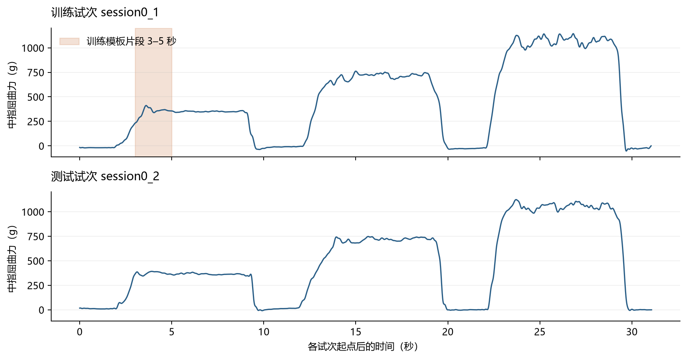
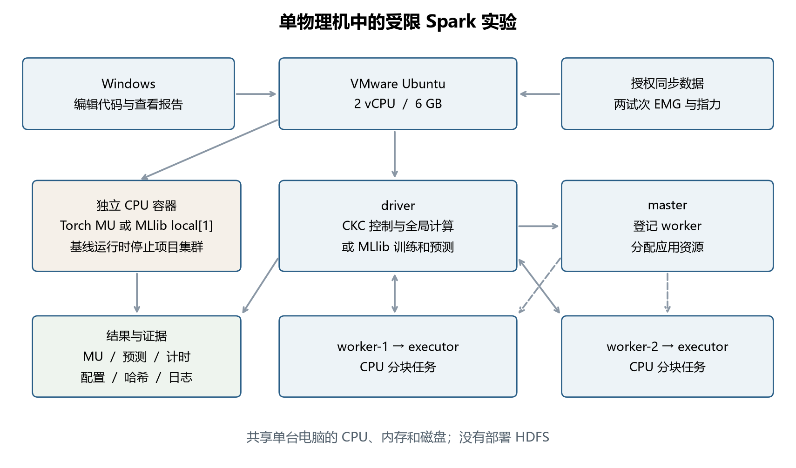
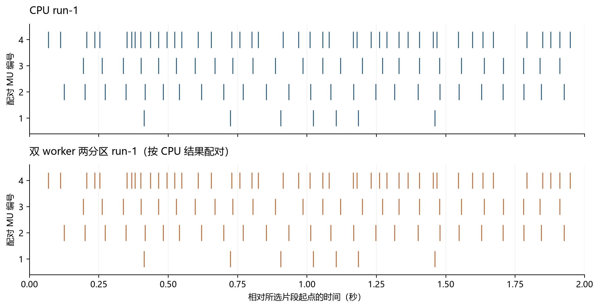
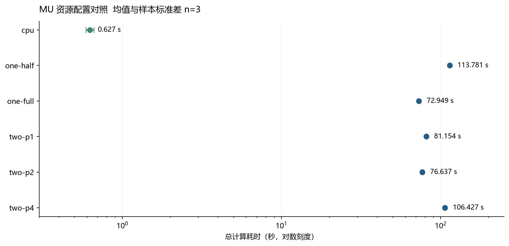
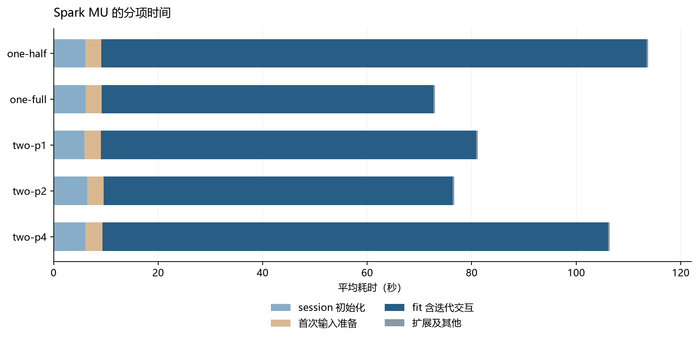
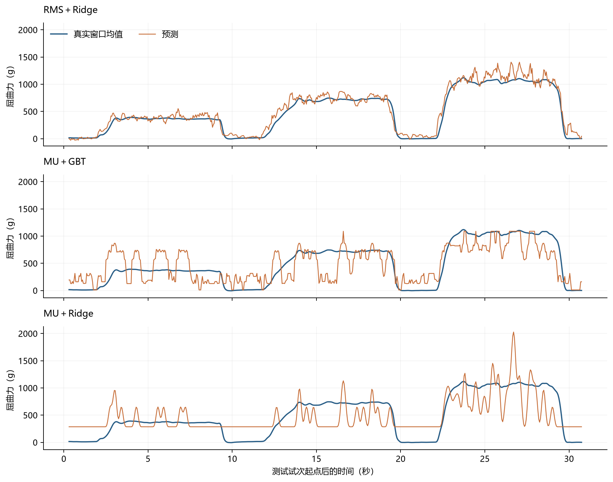
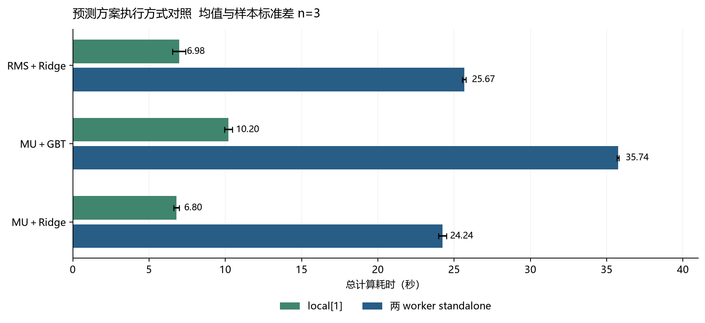

# 资源受限条件下的肌电运动单位分解与指力预测实验报告

实验日期：2026 年 10 月 27 日  
报告整理日期：2026 年 10 月 28 日  
实验批次：`formal-20261027-204319`

## 摘要

本实验在 VMware Ubuntu 中使用 Docker 构建资源受限的单机 Spark 集群，围绕真实肌电数据开展运动单位分解和指力预测两项任务。运动单位分解保留 CKC 主循环，将相关矩阵、向量投影和梯度加权求和三个算子接入 Spark；预测任务分别采用 RMS 特征与固定训练模板得到的 MU 放电率特征，使用 CPU MLlib 的 Ridge 和 GBT 模型训练，并在独立试次上测试。实验设置 CPU 基线、单 worker、双 worker及不同分区配置，每组预热一次、正式运行三次，共完成 12 组、48 次运行，其中 36 次纳入正式统计。

在第一试次第 3–5 秒的 60 通道输入上，各 MU 配置均得到 4 个运动单位，与 CPU 参考结果配对后的放电时刻最大偏差为 1 个采样点。相同总资源上限下，CPU 与双 worker 两分区的平均总计算耗时分别为 0.6268 秒和 76.6370 秒；Spark 在本轮小输入上没有获得加速。固定 worker 总预算后，双 worker 比集中资源的单 worker 耗时增加约 5.06%。指力预测使用第一试次训练、第二试次测试，RMS＋Ridge、MU＋GBT 和 MU＋Ridge 的测试 RMSE 分别为 97.606、253.316 和 289.594 g。本轮 RMS＋Ridge 表现最好，MU 特征并未带来更低误差。结果表明，在当前任务规模和资源配置下，分布式执行的调度、数据准备及迭代交互代价超过了其并行收益。该结论仅适用于本机、这两份试次和所测配置，不能外推到真实多服务器或更大数据规模。

关键词：肌电信号；运动单位分解；Spark；资源限额；MLlib；指力预测

## 1 实验目的与任务

肌电信号由多个运动单位活动叠加形成。运动单位分解尝试从多通道肌电中提取各运动单位的放电时刻，指力预测则研究肌电特征与同步测得的手指作用力之间的对应关系。本实验将两项任务放入同一条数据处理路线，观察部分算子分布式执行是否保持结果一致，以及资源分配、任务分区和模型选择如何影响耗时与预测误差。

实验回答以下问题。

1. 将 CKC 的部分矩阵运算交给 Spark 后，MU 脉冲与质量指标是否与 CPU 参考一致？
2. 增加 worker 资源、固定总预算重新分配资源以及改变分区数，分别带来怎样的耗时变化？
3. RMS 与 MU 放电率特征在独立试次上的预测表现有何差异？
4. 相同 MLlib 模型在 `local[1]` 与 standalone 集群中的运行代价有何不同？

实验采用真实小规模数据验证流程，不把两个试次描述为大数据集。单机模拟的目的在于明确计算、调度与资源限制之间的关系，观察后续扩大任务规模时需要关注的代价。

## 2 数据与训练测试划分

### 2.1 数据来源

数据来自 `processed_0831LDX/session0_1` 和 `session0_2` 的 `aligned_Middle_Trapezoid.mat`，对应 LDX、0°、中指梯形任务。仓库仅提供团队获授权使用的两份精简 NPZ，保留完整同步轨迹，使用 adapter 0 的共同有效通道，转换为 float32，不再次滤波、不降采样。

| 项目 | 训练试次 | 测试试次 |
|---|---|---|
| 文件 | `ldx_0deg_1.npz` | `ldx_0deg_2.npz` |
| 来源 | `session0_1` | `session0_2` |
| EMG 形状 | 60 × 63582 | 60 × 63629 |
| 记录长度 | 约 31.05 秒 | 约 31.07 秒 |
| 同步力形状 | 2 × 63582 | 2 × 63629 |
| 采样率 | 2048 Hz | 2048 Hz |
| 预测窗口数 | 611 | 612 |

力信号两路依次为中指屈曲和伸展，原始记录单位为 g。本实验预测中指屈曲力，保留 g 作为标签单位，没有将其换算成牛顿或 %MVC。时间零点为各原始对齐试次的起点。



图 1 两份试次的同步屈曲力。预测使用完整轨迹中的有效窗口；训练模板只从训练试次的 3–5 秒提取。

### 2.2 两种任务使用不同的时间范围

MU 效率对照统一取第一试次第 3–5 秒，输入为 60 × 4096。扩展系数为 10，经延迟扩展和边缘裁剪后，矩阵为 600 × 4085。所有 MU 资源配置使用同一片段，以控制输入规模。

预测使用两份完整试次。每个窗口的目标值为该窗口内中指屈曲力的均值。窗口宽度和步长分别为 410、102 个样本，约为 200.20、49.80 ms；相邻窗口重叠约 75.12%。两端统一排除 430 个样本，以保证 RMS 与 MU 特征具有相同时间范围。采用左闭右开区间 `[start, stop)`，不使用不完整窗口。

训练与测试按试次划分，而不是混合两份记录后随机拆分相邻窗口。预处理和模板参数仅由训练数据确定，模型参数在测试前固定。本实验没有额外验证试次，测试集用于最终评价，不据此反复调参。

## 3 实验环境与系统架构

### 3.1 软硬件环境

| 项目 | 配置或版本 |
|---|---|
| 运行路线 | Windows 编辑与查看结果，VMware Ubuntu 执行运算 |
| Ubuntu | 24.04.5 LTS，内核 6.8.0-142-generic，x86_64 |
| 虚拟机资源 | 2 vCPU，6 GB 内存，50 GB 虚拟磁盘，NAT |
| VM 识别的 CPU 型号 | AMD Ryzen 9 7945HX with Radeon Graphics；本实验仅分配 2 vCPU |
| Python | Ubuntu 项目环境 3.11.15，Docker 镜像环境 3.11.18 |
| Java | OpenJDK 17 |
| PyTorch | 2.8.0+cpu |
| PySpark | 3.5.7 |
| Docker 与 Compose | Docker Engine 29.8.1，Compose v5.5.1 |

VM 中可见的 CPU 型号不代表实验使用宿主机全部核心。两种正式执行方式使用同一个 CPU 镜像；历史 CUDA 与 WSL 结果没有纳入本轮统计。

### 3.2 数据流与执行角色



图 2 系统架构。CPU 基线独立运行时停止项目集群，Spark 实验由 driver 控制流程并向 executor 提交任务。

master 负责登记 worker 和应用资源调度，worker 启动 executor 执行任务，driver 控制 MU 迭代或 MLlib 训练与预测。Spark standalone 支持在一台机器上启动 master 和 worker 进行测试，本实验采用这一方式。[Spark standalone 文档](https://spark.apache.org/docs/3.5.7/spark-standalone.html)

Docker 用于隔离进程和施加资源上限。两个 worker 都在同一台物理电脑、同一个 Ubuntu VM 中，共享底层 CPU、内存和磁盘。数据已打包到镜像，输出通过绑定目录保存；本实验没有部署 HDFS，不能将容器共享目录描述为 HDFS 分布式存储。

### 3.3 资源限额

基础 `compose.yaml` 定义服务，叠加 `compose.limits.yaml` 后设置 CPU 和内存上限。Docker 的 CPU 配额约束可用 CPU 时间，内存上限约束容器内包括 JVM 和 Python 在内的进程；Spark 的任务槽与 heap 参数是另一层设置。[Docker 资源约束文档](https://docs.docker.com/engine/containers/resource_constraints/)

| 服务 | CPU 上限 | 内存上限 | Spark 或线程设置 |
|---|---:|---:|---|
| master | 0.25 | 384 MiB | daemon heap 128 MiB |
| worker-1 | 0.5 | 1280 MiB | 1 个任务槽，executor heap 512 MiB |
| worker-2 | 0.5 | 1280 MiB | 1 个任务槽，executor heap 512 MiB |
| driver | 0.75 | 1792 MiB | driver heap 768 MiB |
| 默认集群合计 | 2.0 | 4736 MiB | 2 个 executor 任务槽 |
| CPU 基线 | 2.0 | 4736 MiB | 独立容器，Torch 两线程 |

各容器 `memswap_limit` 与内存上限相同，不额外使用容器 swap。CPU 基线与默认集群的总上限相同，但每个进程能够使用的额度、服务划分和线程布局不同，因此不能解释为完全相同的运行环境。例如 CPU 基线的单个 Python 进程可利用两核额度，而 Spark driver 受 0.75 CPU 额度限制。

## 4 方法与实现

### 4.1 CKC 主循环与三个 Spark 算子

实验复用仓库内 CKC 实现，通过 `CKCDecomposer.fit(eSig, ops=None)` 接入可选 Spark 算子。CPU 路径使用原 Torch 运算；Spark 路径按时间轴划分扩展矩阵，每块包含全部扩展通道。设扩展矩阵为 $X\in\mathbb{R}^{C\times N}$，接入点为：

| 算子 | 分块计算与合并 |
|---|---|
| 相关矩阵 | 各块计算 $X_iX_i^T$，归约后除以全局样本数 $N$ |
| 投影 | 广播向量 $a$，计算 $aX_i$，按时间起点排序拼接 |
| 加权求和 | 取对应时间段权重 $w_i$，计算 $X_iw_i$ 后归约 |

相关矩阵使用全局样本数归一化，不对不同长度分块的局部均值做简单平均。梯度所需的边缘屏蔽由调用方处理；投影结果保持时间顺序。Spark worker 使用 NumPy，合并结果返回 driver 的 CPU Torch 张量。

求逆、活动索引、候选选择、质量判断、全局更新和最终去重仍由 driver 执行。driver 持有完整输入，当前实现仅验证部分算子的分布式执行，没有实现超单机内存分解，也没有重写通用后端框架。

MU 参数固定为：第一试次第 3–5 秒、2048 Hz、扩展系数 10、`n_mu_max=5`、`n_iter=30`、`cost_fcn=1`、SIL 阈值 0.8、seed 42。CPU 基线使用两线程，Spark 主入口使用一线程；最终 MU 数由算法搜索、质量筛选和去重决定，参数名不能直接当成最终数量。

### 4.2 RMS 特征

对第 $k$ 个窗口的第 $c$ 个 EMG 通道，计算

$$
\mathrm{RMS}_{k,c}=\sqrt{\frac{1}{L}\sum_{n=s_k}^{s_k+L-1}x_c[n]^2},\qquad L=410.
$$

每个窗口得到 60 维 RMS 特征。标签使用相同采样区间内屈曲力的均值，RMS 与标签之间没有人为加入时间延迟补偿。

### 4.3 固定训练 MU 模板与放电率特征

仅在训练试次第 3–5 秒提取模板，保存投影矩阵、阈值质心、固定正负方向、通道顺序、采样率、扩展系数、训练片段和来源哈希。程序保存 `templates.npz` 后重新载入，再将同一模板应用于完整训练和测试试次。测试试次不重新独立分解并重新编号。

`apply_templates` 的可选固定极性参数保证方向依据训练数据确定。脉冲索引加回扩展裁剪的 10 个样本，恢复到各完整试次时间基准。放电脉冲经 400 ms 居中 Hanning 编码后，按与 RMS 相同的窗口取均值。静默 MU 保留对应列，不根据测试放电情况删除特征。

居中平滑会使用当前时刻之后的邻域信息，因此本实验是离线指力预测。实际模板流水线得到 1 个 MU 特征列，完整训练和测试试次分别检测到 61、67 个脉冲；短片段 MU 性能对照得到 4 个 MU。两者使用不同入口和执行条件，数量不同不能混写，也没有进一步复现其差异原因。特征准备耗时 RMS 为 0.1926 秒，MU 为 3.4007 秒，仅准备一次，正式模型重复运行复用同一份冻结特征。

### 4.4 MLlib 回归模型

Ridge 使用 MLlib `LinearRegression`，`elasticNetParam=0`、`regParam=0.1`、`standardization=True`、`fitIntercept=True`、`solver="normal"`，`maxIter=20`。统计与模型拟合使用训练数据；保存预测时按原窗口编号排序。[LinearRegression 文档](https://spark.apache.org/docs/3.5.7/api/python/reference/api/pyspark.ml.regression.LinearRegression.html)

GBT 使用 `GBTRegressor`，`maxIter=20`、`maxDepth=3`、`stepSize=0.1`、`maxBins=32`、seed 42。模型全部使用 CPU。[GBTRegressor 文档](https://spark.apache.org/docs/3.5.7/api/python/reference/api/pyspark.ml.regression.GBTRegressor.html)

除主线 RMS＋Ridge 与 MU＋GBT 外，增加 MU＋Ridge：固定 Ridge 可比较两种特征表示，固定 MU 特征可比较 Ridge 与 GBT。仅比较 RMS＋Ridge 和 MU＋GBT 会同时改变特征与模型，不能将误差差异全部归因于 MU。

## 5 正式实验设计与统计口径

### 5.1 MU 资源与分区对照

| 配置 | worker 数 | worker 总 CPU／内存 | 含 master 和 driver 的总 CPU／内存 | 任务槽 | 分区 |
|---|---:|---|---|---:|---:|
| CPU | 0 | — | 2.0／4736 MiB | Torch 两线程 | — |
| one-half | 1 | 0.5／1280 MiB | 1.5／3456 MiB | 1 | 2 |
| one-full | 1 | 1.0／2560 MiB | 2.0／4736 MiB | 2 | 2 |
| two-p1 | 2 | 1.0／2560 MiB | 2.0／4736 MiB | 2 | 1 |
| two-p2 | 2 | 1.0／2560 MiB | 2.0／4736 MiB | 2 | 2 |
| two-p4 | 2 | 1.0／2560 MiB | 2.0／4736 MiB | 2 | 4 |

`one-half` 与 `two-p2` 比较每节点额度固定时增加资源的效果；`one-full` 与 `two-p2` 比较固定 worker 总预算与总任务槽时的分配方式；`two-p1/p2/p4` 仅改变输入算子分区数。一个分区不能同时分配给两个 worker，`two-p1` 不要求任务记录中同时出现两个 host。

### 5.2 预测执行方式对照

对 RMS＋Ridge、MU＋GBT、MU＋Ridge 三种方案分别测试 `local[1]` 与两 worker standalone，共六组。local 在 CPU 容器中运行，总上限 2 CPU／4736 MiB，但只使用一个 Spark 任务槽；standalone 使用默认集群资源。两者总额度相同，内部任务并行度和 driver 可用额度不同。

模型输入固定为预先准备好的特征快照，每次运行在自己的新应用中创建、分区并缓存训练和测试数据，通过 action 物化缓存后再训练。没有把上一个应用的已训练模型直接重复预测来替代训练计时。

### 5.3 预热与重复

每组顺序执行 `run-0` 至 `run-3`，`run-0` 作为预热，统计 `run-1/2/3`。共六组 MU、六组 ML，合计 48 次运行、36 条正式记录。预热不是一个持续保留的 JVM；各次为新的应用／driver 进程，后续仍有启动和初始化成本。

固定 seed 42 用于控制算法随机性，三次重复衡量本次机器条件下的运行波动，不代表三个独立受试者或测试试次。均值与样本标准差为

$$
\bar t=\frac{1}{3}\sum_{i=1}^{3}t_i,\qquad s=\sqrt{\frac{\sum_{i=1}^{3}(t_i-\bar t)^2}{3-1}}.
$$

本报告展示样本标准差，不把它作为置信区间。模型误差由同一测试试次重复得到，极小波动不能解释为模型具有确定的泛化能力。

### 5.4 计时范围

| 计时字段 | 范围 |
|---|---|
| MU total | 扩展前至 fit 完成，含 Spark session 初始化、输入分发和迭代 |
| MU fit | CKC 拟合段，包含迭代中的 Spark action 与交互，不等于纯矩阵计算 |
| ML startup | 创建 Spark session 的 Python 计时段 |
| ML distribution | DataFrame 创建、组装特征、分区、缓存物化及输入 host 检查 |
| ML fit／predict | 模型拟合／测试预测排序与收集 |
| ML total | 创建 session 至预测及误差计算完成，不含特征准备、保存模型和绘图 |
| wall | 外层命令的整秒耗时，包含容器运行、保存和清理等等待 |

容器中的 `spark-submit` 启动 JVM 的部分发生在 Python 内部计时之前，不能把 startup 字段当成完整 JVM 启动耗时。内部 total 与外部 wall 也不能混用。安装依赖、下载和镜像构建均不计入算法时间。

## 6 结果正确性与可追溯性

### 6.1 MU 脉冲配对

以 CPU `run-1` 为参考，对 MU 脉冲序列进行一对一匹配。只有脉冲数相同才作为可匹配项，以最大采样点偏差构建代价矩阵并完成分配，判据为匹配后所有脉冲偏差不超过 1 个采样点。2048 Hz 下一个样本约为 0.488 ms。

24 次 MU 运行包含预热，均为 4 个 MU，脉冲数量为 7、25、25、44。各配置配对后最大偏差为 1 个样本，SIL 范围为 0.935172–0.983919，PNR 范围为 20.0785–27.2826 dB。相对参考结果的最大 PNR 差约 0.003266 dB，最大 SIL 差约 0.000200。



图 3 CPU 与 two-p2 的 run-1 放电时刻。Spark 的 MU 顺序按脉冲匹配结果重排，横轴恢复到所选 2 秒片段的时间基准。

上述结果支持本轮不同执行配置的工程一致性。由于没有生理真值，不能据此断言提取了全部真实运动单位。浮点归约顺序也可能造成微小的迭代差异，不要求质量指标逐位相同。

### 6.2 预测文件与时间对齐

RMS 与 MU 特征的训练、测试窗口起止样本及标签相同；测试模板列与训练模板保持同一含义。检查预测 CSV 的时间和真实标签后，重新计算 RMSE 与 MAE，与各次 `metrics.json` 一致。以 $M=612$ 个测试窗口计，

$$
\mathrm{RMSE}=\sqrt{\frac{1}{M}\sum_{i=1}^{M}(\hat y_i-y_i)^2},\qquad
\mathrm{MAE}=\frac{1}{M}\sum_{i=1}^{M}|\hat y_i-y_i|.
$$

模型目录、曲线和特征元数据存在。cluster2 的输入任务记录包含 `worker-1` 和 `worker-2`，但这些记录只证明输入分发任务参与，不证明每个 ML 训练阶段都由两个节点并行完成。本次文件核对没有逐个重新载入全部真实模型；小型模型保存／载入测试通过，不能替代这一项实际模型复测。

### 6.3 输入和运行证据

正式批次的 12 项输入快照、配置与正式脚本哈希全部匹配，两份数据的 SHA256 与特征元数据一致。保留镜像 ID、Compose 文件、各组解析配置、master／worker 的 inspect 限额、driver／CPU 的 `runtime.cgroup`、逐次日志、墙钟时间和组级 SUCCESS 标记。

Ubuntu 用户提供的测试输出为 Ruff 通过、pytest 17 passed、1 skipped、1 warning；CUDA 项在 CPU VM 中跳过，警告为 PySpark 的 distutils 弃用提示。该测试证据与真实原始结果核对相互补充，环境平方和算例通过本身不代表 MU 或预测正确。

## 7 MU 性能结果与分析

### 7.1 总耗时与分项耗时

表中单位均为秒，均值与样本标准差来自三次正式运行。所有配置最终均保留 4 个 MU。

| 配置 | total 均值 ± 标准差 | startup 均值 | distribution 均值 | fit 均值 | wall 均值 |
|---|---:|---:|---:|---:|---:|
| cpu | 0.6268 ± 0.0367 | 0.0000 | 0.0000 | 0.6206 | 2.333 |
| one-half | 113.7807 ± 0.4928 | 6.0460 | 3.0719 | 104.3647 | 120.000 |
| one-full | 72.9489 ± 0.2529 | 6.1038 | 3.1170 | 63.4309 | 79.333 |
| two-p1 | 81.1543 ± 0.6651 | 5.8712 | 3.1524 | 71.8326 | 87.333 |
| two-p2 | 76.6370 ± 1.4979 | 6.4139 | 3.1799 | 66.7365 | 83.000 |
| two-p4 | 106.4268 ± 0.5159 | 6.0304 | 3.3010 | 96.8066 | 112.667 |



图 4 MU 平均总计算耗时与样本标准差。对数横轴用于同时展示 CPU 和 Spark 的数量级差异，不改变原始统计值。



图 5 Spark MU 分项均值。余项为 total 减去 startup、distribution、fit，包含扩展及其他未单列代码段；fit 已包含迭代交互，不能将其等同于纯计算。

### 7.2 CPU 与 Spark

相同总上限下，CPU 为 0.6268 秒，two-p2 为 76.6370 秒，后者约为前者的 122.26 倍。该时间比同时包含执行结构和资源分配差异：CPU 使用两线程，Spark driver 使用一线程且受 0.75 CPU 限额，不能把全部差异都归因于网络。

two-p2 的 fit 均值为 66.7365 秒，约占其 total 的 87.08%；session 初始化和首次分发合计约 9.5939 秒。即使只关注拟合阶段，差距仍很明显，因此“Spark 只是启动慢”不足以解释本次结果。更合理的解释是，小矩阵操作被放进频繁的 driver／executor 交互中，单次可并行计算量有限，控制与调度成本反复出现。当前没有独立的纯通信计时或剖析数据，这一解释属于与实现和分项计时一致的分析，不能进一步给出通信占比。

### 7.3 增加 worker 总资源

从 one-half 到 two-p2，每节点额度不变，worker 总 CPU 从 0.5 增至 1.0，总内存从 1280 增至 2560 MiB，任务槽从 1 增至 2；包含 master／driver 的总上限由 1.5 CPU／3456 MiB 增至 2 CPU／4736 MiB。耗时从 113.7807 降至 76.6370 秒，减少约 32.64%，耗时比为 1.485。

这一结果说明，在所测 Spark 配置中增加资源可以降低运行代价，但节点数、worker 总资源和任务槽同时增加，不能称为固定资源下的并行加速，也不能据此推断线性扩展性。

### 7.4 固定 worker 总预算

one-full 与 two-p2 的 worker 总预算均为 1 CPU／2560 MiB，master／driver 不变，总任务槽同为 2。one-full 为 72.9489 秒，two-p2 为 76.6370 秒，拆成双 worker 后增加约 5.06%。三次重复支持这一批次中的均值差异，但未进行更大样本的显著性检验。

该结果没有显示把同样预算拆到两个 worker 的收益。一个节点集中资源能够避免部分跨 executor 交换，但单个 worker 下仍可能有多个 executor，不能将 one-full 描述为完全没有分布式执行开销。

### 7.5 分区数变化

在相同双 worker 和额度下，1、2、4 分区分别为 81.1543、76.6370、106.4268 秒。两分区比一分区减少约 5.57%，四分区比两分区增加约 38.87%。在本轮数据与两个任务槽下，两分区是所测三个选择中耗时最低的配置。

分区从 1 增到 2 提供了更多同时执行的机会，而 4 分区会在同样资源上安排更多任务。小分块带来的调度和结果合并代价可能超过收益；尚无证据证明两分区对更长片段或其他候选／迭代参数仍然最优。

## 8 指力预测结果与分析

### 8.1 独立试次误差

以下为三次正式运行的平均误差，两种执行方式保留各自记录。训练均值基线始终预测训练标签均值，其测试 RMSE 为 383.8529 g。三次误差在保存精度内相同或仅有约 $10^{-10}$ g 的浮点差异，误差重复不是新的独立测试。

| 方案 | 特征维数 | 执行方式 | RMSE 均值 g | MAE 均值 g |
|---|---:|---|---:|---:|
| RMS＋Ridge | 60 | local[1] | 97.606097 | 73.683490 |
| RMS＋Ridge | 60 | standalone | 97.606097 | 73.683490 |
| MU＋GBT | 1 | local[1] | 253.316040 | 207.204404 |
| MU＋GBT | 1 | standalone | 253.316040 | 207.204404 |
| MU＋Ridge | 1 | local[1] | 289.593967 | 245.534836 |
| MU＋Ridge | 1 | standalone | 289.593967 | 245.534836 |

RMS＋Ridge 相对训练均值基线的 RMSE 降低约 74.57%，MU＋GBT 降低约 34.01%，MU＋Ridge 降低约 24.56%。同为 Ridge 时，RMS 的误差明显低于当前一维 MU 特征；同为 MU 特征时，GBT 优于 Ridge。因此，本轮既没有观察到 MU 替代 RMS 的优势，也不能由此判定 MU 特征在其他模板范围或数据条件下无效。

### 8.2 真实曲线与预测曲线

图示统一选 cluster2 的 `run-1`，没有根据误差挑选最好的一次。横轴取窗口中心，标签仍是同一窗口内力的均值，没有为了对齐曲线进行事后平移。



图 6 三种方案在第二试次的预测曲线。纵轴均为 g，所有子图使用相同范围。

RMS＋Ridge 能较好跟随三个不同幅度的作用力阶段，在较高平台区仍存在明显波动和局部高估。较低的总体误差并不表示逐窗口无误差。MU＋GBT 的预测存在较明显跳变，部分低力区出现非零预测，在平台区也有多次突然降低；MU＋Ridge 受一维输入与线性关系限制，无法充分复现各平台变化。

当前 MU 特征只有一列，训练模板仅来自第 3–5 秒，未必覆盖更高作用力阶段的全部运动单位；完整试次检测到的脉冲也较稀疏。这可能限制特征包含的指力信息。但该推测尚未通过改变模板片段的独立对照验证，报告不把它写成已经确认的唯一原因。

此外，RMS 直接汇总 60 通道信号能量，而 MU 特征汇总一个模板的脉冲活动，信息维度和表示方式均不同。模型复杂度增加不能自动补回输入中缺失的信息。若后续改进，模板区间和模型参数应依据训练数据或新增验证试次选择，不能依据当前测试曲线反复优化后仍声称保持独立评价。

### 8.3 预测耗时

下表为三次正式运行均值，total 列同时给出样本标准差，所有时间单位为秒。特征准备不计入这些值。

| 方案 | 执行方式 | total 均值 ± 标准差 | startup | distribution | fit | predict |
|---|---|---:|---:|---:|---:|---:|
| RMS＋Ridge | local[1] | 6.9781 ± 0.4297 | 0.7597 | 5.2280 | 0.6208 | 0.3497 |
| RMS＋Ridge | standalone | 25.6673 ± 0.1174 | 6.4406 | 16.1014 | 1.8768 | 1.2288 |
| MU＋GBT | local[1] | 10.2031 ± 0.2692 | 0.8462 | 5.0173 | 3.9780 | 0.3425 |
| MU＋GBT | standalone | 35.7426 ± 0.0686 | 6.5899 | 14.5104 | 13.5781 | 1.0523 |
| MU＋Ridge | local[1] | 6.8025 ± 0.1746 | 0.7957 | 5.0103 | 0.6465 | 0.3230 |
| MU＋Ridge | standalone | 24.2351 ± 0.2511 | 6.5334 | 14.5980 | 1.9826 | 1.1048 |



图 7 三种模型方案的平均总耗时和样本标准差。

集群相对 local 的总耗时倍数分别为：RMS＋Ridge 3.68、MU＋GBT 3.50、MU＋Ridge 3.56。两种执行方式的测试误差几乎相同，因此集群的主要变化表现为执行代价增加，没有带来预测精度提升。

以 RMS＋Ridge 集群为例，distribution 均值为 16.1014 秒，约占 total 的 62.73%，fit 和 predict 分别为 1.8768、1.2288 秒。这里 distribution 包含数据框创建、特征组装、缓存物化和输入 host 检查，不能直接解释成纯网络传输。训练仅有 611 行，且特征最多 60 维，模型拟合规模有限，分布式数据准备成本更容易成为主要负担。

GBT 的拟合时间高于 Ridge，集群与 local 均如此。MU＋GBT 集群 fit 为 13.5781 秒，local 为 3.9780 秒；这与迭代树训练的任务结构和不同资源布局有关，本实验没有进一步拆分各训练阶段以判定确切瓶颈。

## 9 实验局限与改进方向

### 9.1 数据与预测评价范围

数据仅涉及同一来源条件的两份试次，测试窗口重叠，612 个测试窗口不能视作 612 个独立受试样本。本实验未验证跨人、跨姿态和跨天泛化，也没有预测区间或统计显著性结论。Hanning 居中平滑使用未来邻域信息，当前结果仅适用于离线分析。

### 9.2 资源与计时边界

单机 VM 中的容器共享物理资源，网络为本地虚拟网络，无法替代真实服务器间的带宽和时延。实验保留了 VM 配置与容器上限，但没有连续记录宿主机负载、峰值 RSS、实际 CPU 使用率或独立纯通信耗时。相同总额度并不意味着相同 driver 额度与线程布局，时间差需结合这些条件解释。

### 9.3 实现与可复现边界

driver 持有全量输入并控制迭代，当前架构不能直接处理超过 driver 内存的数据。镜像 ID、输入哈希和正式脚本副本能够追溯本轮运行，但本轮代码在提交前存在未提交修改；不能只用旧 Git 提交号代表完整镜像源码。当前保存模型未逐个重新载入复测，需要严格交付模型时可补做这一项检查。

### 9.4 后续实验

可在保持数据来源和评价方式清晰的前提下增加真实输入长度、调整候选／迭代规模，观察计算量提高后 Spark 的代价是否被摊薄；不能简单复制窗口后宣称增加了独立样本。针对预测，可依据训练数据覆盖更多作用力阶段提取模板，并通过额外验证试次选择参数。针对性能，可补采 Spark UI 任务证据、宿主机资源曲线和更细的代码段剖析，再决定是否调整广播、缓存或交互粒度。这些均为后续方向，不属于本报告已完成结果。

## 10 结论

本实验完成了资源受限单机 Spark 环境中的真实 MU 分解与指力预测，实现了固定输入、资源限额、训练测试隔离、模板复用、预热重复和原始结果追溯。24 次 MU 运行与 CPU 参考的配对脉冲偏差不超过 1 个样本，说明所测配置在本轮输入上具有工程一致性。

性能结果没有支持“使用 Spark 一定更快”。增加 worker 总资源可降低 Spark 耗时，但固定预算拆成双 worker 没有优于集中资源的单 worker；在所测分区中两分区最快，四分区增加任务开销。预测任务同样在 local 模式下耗时更低，集群没有改变误差结果。

在当前独立试次评价中，RMS＋Ridge 的 RMSE 为 97.606 g，优于 MU＋GBT 和 MU＋Ridge。短训练片段得到的一维 MU 特征尚不足以体现相对 RMS 的优势。实验的价值在于通过可核对数据明确部分算子分布式执行的条件与代价，为后续扩大规模和改进特征提供依据。

## 参考资料

1. Apache Spark 3.5.7. [Spark Standalone Mode](https://spark.apache.org/docs/3.5.7/spark-standalone.html).
2. Apache Spark 3.5.7. [PySpark LinearRegression](https://spark.apache.org/docs/3.5.7/api/python/reference/api/pyspark.ml.regression.LinearRegression.html).
3. Apache Spark 3.5.7. [PySpark GBTRegressor](https://spark.apache.org/docs/3.5.7/api/python/reference/api/pyspark.ml.regression.GBTRegressor.html).
4. Docker. [Resource constraints](https://docs.docker.com/engine/containers/resource_constraints/).
5. 本项目 `src/mu_course/ckc/SOURCE.md`、`src/mu_course/data/metadata.json`、`docs/BACKEND_CONTRACT.md`，以及正式批次的原始参数、预测 CSV 和质量检查文件。

## 附录 A 三次正式运行的原始记录

仅列内部 total 秒数；预热 run-0 未纳入。误差列为三次独立运行各自保存的 RMSE，统一保留六位小数；相同显示值不表示重新获得了独立测试数据。

| 配置 | run-1 total 秒 | run-2 total 秒 | run-3 total 秒 | 三次 RMSE g |
|---|---:|---:|---:|---|
| mu-cpu | 0.639836 | 0.655203 | 0.585414 | — |
| mu-one-half | 113.306180 | 114.289999 | 113.745841 | — |
| mu-one-full | 73.215429 | 72.918999 | 72.712317 | — |
| mu-two-p1 | 81.882777 | 81.000809 | 80.579410 | — |
| mu-two-p2 | 78.091918 | 76.719665 | 75.099555 | — |
| mu-two-p4 | 105.975298 | 106.989076 | 106.316043 | — |
| ml-local1-rms-ridge | 7.404461 | 6.984914 | 6.545062 | 97.606097 / 97.606097 / 97.606097 |
| ml-cluster2-rms-ridge | 25.802858 | 25.596872 | 25.602216 | 97.606097 / 97.606097 / 97.606097 |
| ml-local1-mu-gbt | 10.012900 | 10.085288 | 10.511063 | 253.316040 / 253.316040 / 253.316040 |
| ml-cluster2-mu-gbt | 35.731095 | 35.680602 | 35.816247 | 253.316040 / 253.316040 / 253.316040 |
| ml-local1-mu-ridge | 6.644670 | 6.772770 | 6.990112 | 289.593967 / 289.593967 / 289.593967 |
| ml-cluster2-mu-ridge | 24.501668 | 24.003015 | 24.200511 | 289.593967 / 289.593967 / 289.593967 |

## 附录 B 复现与证据索引

原始批次位于仓库 `outputs/vm-results/formal-20261027-204319/`。报告图片从这一批次的 NPZ／CSV 或已冻结数据重新绘制，仅整理呈现，不重新分解或训练。当前交付目录为 `docs/report/`，报告引用图片集中在同级 `figures/`，精选证据集中在 `results/`；完整筛选规则见 [精选结果说明](results/RESULTS_GUIDE.md)。

可以直接查看 [36 条正式记录](results/formal_runs.csv)、[12 组汇总](results/formal_summary.csv) 和 [MU 正确性记录](results/mu-correctness.json)。原始示例固定选 run-1：MU 的 CPU／two-p2 参数与 NPZ，以及三种 cluster2 预测方案的 CSV／指标。其余运行、模型和模板保留在完整原始批次，下表列出原批次的完整证据位置。

| 内容 | 原始文件或位置 |
|---|---|
| 逐次正式统计 | `formal_runs.csv` |
| 各组均值与样本标准差 | `formal_summary.csv` |
| MU 脉冲、SIL、PNR 与配对结果 | `mu-*/run-*/mu_results.npz`、`mu-correctness.json` |
| 预测真实值、预测值与指标 | `ml-*/run-*/predictions.csv`、`metrics.json` |
| 固定 RMS／MU 特征及模板 | `features-rms/`、`features-mu/` |
| 服务配额与运行限额 | `config/`、各组 `compose.resolved.yaml`、`limits.txt`、运行 JSON 中的 `runtime.cgroup` |
| 执行证据 | 各组 `run-*.log`、`run-*.wall-seconds.txt`、`SUCCESS` |
| 环境与哈希 | `evidence/`、`input-sha256.txt`、`image-id.txt` |

镜像标识：

```text
sha256:26683a9106c38f3d3568e0d9e1ae80d12f0ba37009bcad424ac61cb26921c44f
```

数据 SHA256：

```text
ldx_0deg_1.npz  29f5f3b22edf60592d97d6a7e4b32ff7b8e58495a2fc14e531684ad4f883271e
ldx_0deg_2.npz  cf8b8d22c412fd086e668585d255c6c15d21eeb4752f412ab5ec3783d5ea1be7
```

正式运行入口为 `scripts/run_formal_group.sh`，检查与汇总入口为 `scripts/check_formal_mu.py`、`scripts/summarize_formal.py`，详细操作见 [统一指南](../START_HERE.md)。`docs/report/` 中的报告、配图与精选结果作为本次准备提交的内容；完整 `outputs/` 继续被 Git 忽略。复制交付材料时保留整个 `docs/report/`，避免图片和精选证据链接失效。交付文件校验清单为 [SHA256SUMS.txt](SHA256SUMS.txt)，来源对应关系见 [SOURCE_FILES.json](results/SOURCE_FILES.json)。
